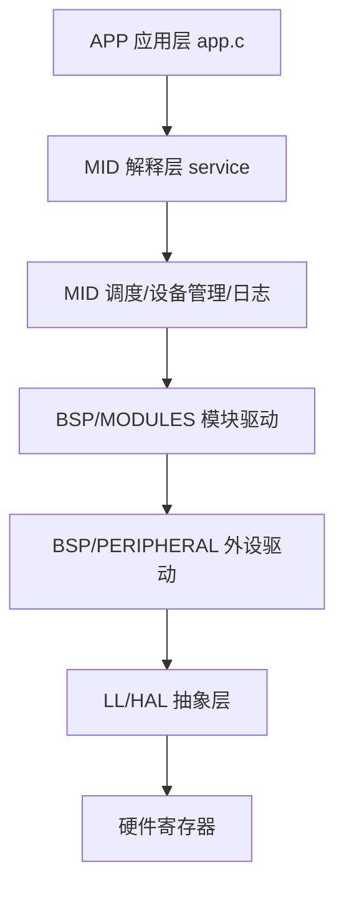
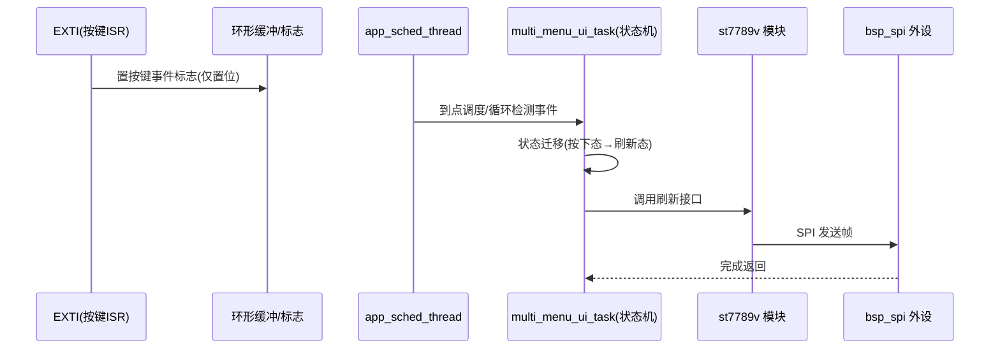

# framework.md 生成模板（S3 必交付产物）

> 目录
> 1. 交付定位与生成规则
> 2. 章节结构固定模板（三章）
> 3. 图示规范（Mermaid 类型选择与 SystemView 要素映射）
> 4. 实测数据规则（禁止编造耗时）
> 5. T2 增量更新规则
>
> `framework.md` 是工程的架构说明书与运行视图：讲清「分几层、怎么调度、函数怎么串起来、中断何时抢占」。T1 整机任务完整产出；T2/T3 任务按第 5 节增量更新；T5 只更新第 1 节。

## 1. 交付定位与生成规则

1. 文件名为 `framework.md`，放工程根目录或文档目录；与 `hardware.dts` 并列构成「硬件台账 + 软件架构」双文档。
2. 三章顺序固定：分层架构 → 软件架构（调度/模式/模块化）→ 运行视图（调用链/时间线/中断抢占）；小节编号不得删改，无内容写 `N/A` 并注明原因。
3. 架构事实来自 S3.1 架构确认表；执行范式/调度/设计模式结论来自 `software-arch.md`；模块化要点来自 `module-convention.md`；依赖关系来自 `architecture.md` D1–D6。
4. 图一律使用 Mermaid 代码块（可直接渲染）；图中节点命名与代码函数名一致。
5. 禁止省略运行视图章：哪怕工程只有一个循环任务，也要给出主循环调用顺序与中断清单。

## 2. 章节结构固定模板（三章）

```markdown
# <工程名> Framework 设计说明

## 1. 分层架构
### 1.1 层级表
| 层 | 目录 | 职责 | 典型文件 | 允许调用下层 |
（行数按实际层级，表头固定五列）

### 1.2 目录树（工程根目录完整骨架）
（text 代码块树形结构；照 architecture.md 3.1 骨架输出：`APP/`、`MID/`、`BSP/MODULES/`、`BSP/PERIPHERAL/`、只读库目录、构建目录；本次新增文件在树中标注相对路径；现有工程沿用现目录并附「默认层→现目录」映射表）

### 1.3 调用方向图
（Mermaid flowchart，单向自上而下；禁止依赖用虚线并文字标注）

### 1.4 模块依赖矩阵
| 模块(行) \ 依赖(列) | PERIPH-spi | PERIPH-adc | MID-sched | ... |
（单元格填调用接口名；空 = 无依赖）

## 2. 软件架构（五维度：执行范式 → 调度模式 → 设计模式 → 模块化要点 → 共享数据）
### 2.1 执行范式
- 结论（前后台 / 事件驱动 / 抢占式多任务，三选一）
- 选型理由（1~3 条，对照 software-arch.md 第 2 节适用与代价列）
- 判定依据（内存约束 / 抢占需求 / 阻塞等待占比）

### 2.2 调度模式
- 调度机制结论（时间片轮询 / 事件队列分发 / RTOS 优先级抢占；范式与调度必须匹配）
- 时基来源（SysTick 1ms / 硬件定时器 / RTOS tick）与计数变量
- 任务与时间变量表
| 任务名 | 触发类型(周期/一次性/条件) | 周期 ms | 实现位置(文件:函数) | 状态集 | 数据来源/去向 |
（范式为 RTOS 时改为：任务名|优先级|周期/触发|栈大小|阻塞点；对照 software-arch.md 3.3 三类型填写）

### 2.3 设计模式清单
| 模式 | 落点模块/文件 | 解决的问题 |
（照 software-arch.md 4.7 清单勾选；未使用的模式不列空行）

### 2.4 模块化要点
- 私有变量与 get/set 接口清单
- 句柄实例清单（模块 | 获取函数 | 绑定的外设句柄）
- 单向依赖约束执行情况（对照 architecture.md D1–D6）

### 2.5 共享数据与临界区
| 共享数据 | 生产者(ISR/任务) | 消费者 | 保护方式(volatile/环形缓冲/临界区/互斥量) |

## 3. 运行视图（SystemView 风格）
### 3.1 启动调用链（初始化顺序）
### 3.2 主循环调度时间线（甘特/时间轴）
### 3.3 中断来源与抢占关系表
### 3.4 关键事件上下文链（典型事件一次完整流转）
### 3.5 函数耗时预算表（预估 + 实测回填列）
### 3.6 实测采集指引（工具与观测点）
```

## 3. 图示规范（Mermaid 类型选择与 SystemView 要素映射）

### 3.1 图类型选用

| 小节 | 图类型 | 表达内容 |
|---|---|---|
| 1.3 调用方向图 | `flowchart TD` | 层与层、模块与模块的单向调用边 |
| 3.1 启动调用链 | `sequenceDiagram` | `main → app_init 三步 → 调度/循环线程` 的顺序与初始化内延时 |
| 3.2 调度时间线 | `gantt` 或 `timeline` | 各任务周期窗口与调度顺序；标注状态机任务为连续运行 |
| 3.4 事件上下文链 | `sequenceDiagram` | 按键/传感器数据/故障事件从 ISR 到业务动作的完整消息流 |
| 状态机任务内部 | `stateDiagram-v2`（任务多时可选） | 状态迁移条件 |

### 3.2 SystemView 要素 → 文档映射表

| SystemView 观测要素 | framework.md 落点 | 文档形态 |
|---|---|---|
| 事件（Event） | 3.4 事件链；2.2 触发类型列 | 事件名 + 来源（ISR/任务/超时） |
| 执行跨度 span（任务进入到退出） | 3.5 函数耗时预算表 | 预估耗时列；实测列待回填 |
| 调度甘特（任务运行时序） | 3.2 时间线图 + 2.2 周期表 | gantt 任务条；周期与顺序 |
| 函数进入/退出（call stack） | 3.1 启动链 + 3.4 事件链 sequenceDiagram | 自顶向下调用箭头与返回 |
| 中断抢占（ISR 打断任务） | 3.3 中断表 + 3.2 图中中断条带标注 | 中断源、优先级、被抢占任务、临界区说明 |
| 空闲/低功耗 | 3.2 末尾空闲说明（如启用） | 空闲任务/睡眠条件简述 |

### 3.3 可直接套用的图示例

调用方向图：



调度时间线（周期任务 + 连续状态机任务 + 中断带）：

```mermaid
gantt
    title 主循环调度时间线（规划视图，耗时待实测回填）
    dateFormat X
    axisFormat %s ms
    section 调度线程
    菜单周期任务(5ms)        :active, a1, 0, 5
    采样周期任务(10ms)      :a2, after a1, 10
    保护周期任务(10ms)      :a3, after a1, 10
    section 循环线程(状态机连续运行)
    UI状态机                :crit, b1, 0, 1
    器件协议状态机          :b2, after b1, 1
    section 中断
    SysTick 1ms             :milestone, i1, 0, 0
    USART1 RX 中断          :milestone, i2, 3, 0
```



关键事件链（以按键触发菜单刷新为例）：



## 4. 实测数据规则（禁止编造耗时）

| 数据类别 | 文档中允许的内容 | 禁止内容 |
|---|---|---|
| 任务周期、状态枚举、调用关系、中断源 | 依据需求与代码直接确定，可写实值 | — |
| 预估执行耗时（us/ms） | 必须标注 `[预估]`，给量级（如 `<1ms`） | 编造精确微秒数值 |
| 实测耗时、最大中断延迟、CPU 占用率 | 留「实测值」空列，注明采集工具与条件后由实测回填 | 凭空填写实测数字 |
| 优先级、周期、频率参数 | 取自台账与代码，可写实值；未核实标 TODO | 猜测寄存器位级配置 |

3.5 表格固定列：`函数/任务 | 调用层级 | 是否含阻塞调用 | 预估耗时[预估] | 实测耗时[待回填] | 观测方法`。实测回填来源写明：SystemView 时间戳、示波器翻转引脚、逻辑分析仪协议周期。

## 5. T2/T3 增量更新规则

| 任务类型 | framework.md 更新范围 |
|---|---|
| T2 单外设增补 | 1.4 依赖矩阵加行/列；2.1 范式无变化写「无变更」；2.2 任务表加行（若新增周期任务/触发方式变化）；2.3 模式清单变化时增删行；3.3 中断表加行（若新增 ISR）；3.4 补对应事件链；其余章节写「无变更」 |
| T3 逻辑修改 | 2.1 范式若调整给变更说明；2.2 状态集/触发条件/周期；2.3 模式落点变化；3.4 事件链；3.5 涉及函数预估列；架构层无变化时 1.x 节写「无变更」 |
| T4 排查后修复 | 仅更新 3.3/3.5 受影响行；不重排整体结构 |
| T5 台账维护 | 仅更新第 1 节层级表与依赖矩阵；代码侧章节标注「未变」 |

增量输出格式：先给「本次变更小节清单」，再给受影响小节的替换内容；未涉及小节标题保留并标注「无变更」，保持文档结构完整。
