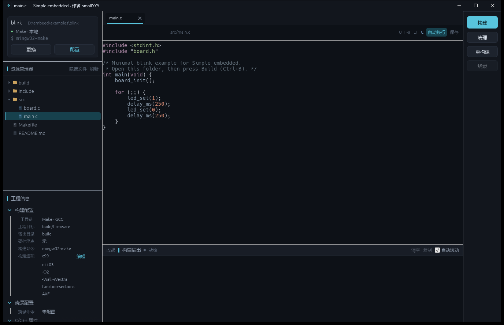
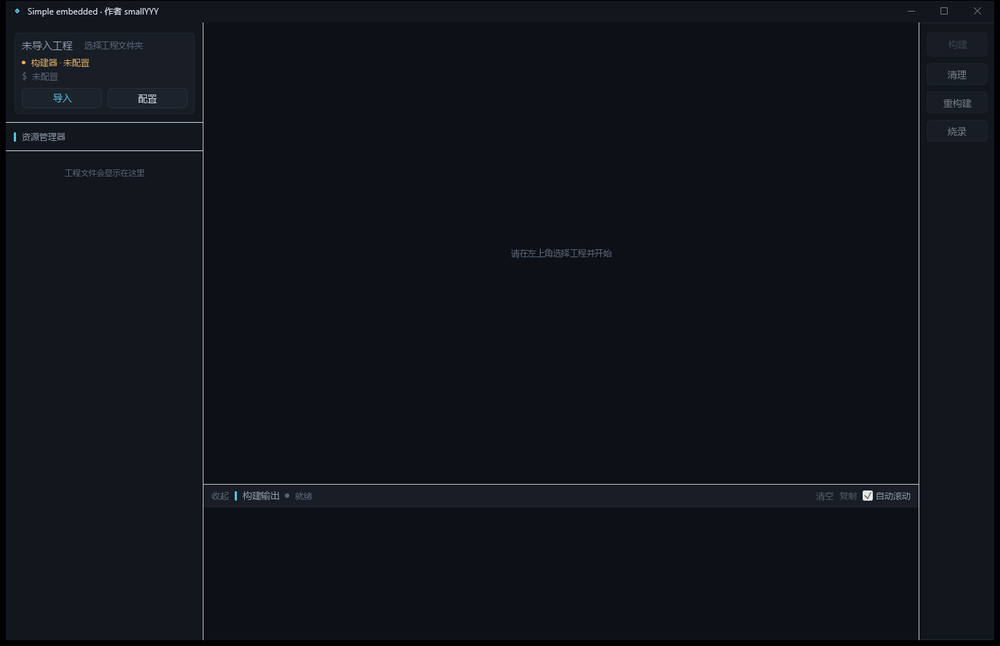

# Simple embedded

一个 Windows 桌面端的极简嵌入式编辑器：**文件夹就是工程**，导入目录 → 编辑代码 → 一键构建 → 查看彩色日志。没有工程向导，没有芯片包，没有存储器布局，也不会向工程目录写入任何项目文件。

使用 Rust + `eframe/egui` 编写。界面左侧构建卡片显示工程名、路径和构建命令，下面是文件树；中间是多标签代码编辑，底部是异步构建输出，操作集中在右侧栏。



未打开工程时，左上角仍显示同一个构建卡片，只是名称/路径显示为未导入状态，操作按钮为“导入 / 配置”。



从打开目录到构建、SSH、烧录和常见问题的完整中文教程：[docs/TUTORIAL.md](docs/TUTORIAL.md)。烧录工具（ST-Link、CubeProgrammer、OpenOCD、pyOCD、J-Link、Keil）的详细配置：[docs/FLASH.md](docs/FLASH.md)。

## 功能

- 打开任意文件夹作为工程，不做 `Makefile` / `Cargo.toml` / `CMakeLists.txt` 之外的项目配置
- 深色标题栏与界面配色一致，构建 / 清理 / 重构建 / 烧录集中在右侧操作栏；设置从构建卡片的“配置”或 `Ctrl+,` 打开
- 左侧栏全高，资源管理器与工程信息默认各占一半高度；文件树较短时工程信息自动上移紧接文件列表；文件树较长时可拖动中间分割线调整比例；拖动左栏右边缘可调整宽度；分割比例和折叠状态会保存
- 左侧构建卡片显示工程名（加粗）、完整路径、构建模式和命令；未导入时按钮为“导入 / 配置”，导入后为“更换 / 配置”
- 工程信息树：分组和列表标题左侧都有折叠箭头，整行可点击并显示淡蓝色选中背景；从 Makefile 或 Keil `.uvprojx` 读取 CPU、浮点、链接脚本、内存布局、包含目录、库搜索目录、宏定义和烧录配置；列表右侧 `+` 可添加；Makefile 工程保存时同步到 Makefile（自动备份），Keil `.uvprojx` 只读
- 构建选项：包含全局选项、C/C++ 编译器、汇编器和链接器四个页面；Make 工程打开时读取现有 `OPT` / `CFLAGS`，保存时按差异写回；选择 `AXF` 会生成 `.axf` 副本规则；Keil 工程只保存在本机设置
- 左侧目录树：第一行显示工程根目录，可展开/折叠；支持隐藏文件、刷新、点击打开文件；右键可在资源管理器或 VS Code 中打开
- 多文件 Tab、脏标记、关闭前提示保存
- 文本编辑：`Ctrl+S` 保存、Tab 缩进、撤销/重做、复制粘贴等由 egui 文本编辑控件提供
- syntect 语法高亮：C/C++/ASM/Rust/Makefile/CMake/TOML/JSON 等
- 自动换行开关、代码字号调节、相对行号、空白字符、换行标尺、CRLF/LF 保持
- 查找 / 替换：大小写、正则、上下一个、全部替换，匹配高亮
- Build / Clean / Rebuild / Flash 在后台线程执行，UI 不冻结
- 实时抓取 stdout/stderr，解析 ANSI 颜色，按 `error` / `warning` 自动标红/标黄
- 构建前自动保存所有脏文件；可停止构建进程树
- 构建输出面板顶部可拖动调高度，收起后也能向上拉出；高度会保存
- 本地构建或远程 SSH 构建（复用系统 OpenSSH）
- Flash 命令可选，在本地工程目录执行，方便接 J-Link / OpenOCD
- 每工程独立构建配置，保存在用户目录，不污染工程
- 可追加工具链 PATH；本地 Make 构建会自动接入 Git for Windows / MSYS 的 `rm` 等 Unix 工具

## 运行

需要 Rust 1.92+（开发环境使用 Rust 1.99）。目标平台为 Windows，代码也保留了 Linux/macOS 的本地构建分支。

```powershell
cargo run --release
```

也可以直接带工程路径启动，第二个参数会额外打开一个文件：

```powershell
cargo run --release -- D:\firmware\my-board src\main.c
```

构建后的可执行文件：

```text
target\release\simple-embedded.exe
```

## 快捷键

| 快捷键 | 操作 |
| --- | --- |
| `Ctrl+O` | 打开工程文件夹 |
| `Ctrl+S` | 保存当前文件 |
| `Ctrl+Shift+S` | 保存所有文件 |
| `Ctrl+B` | Build |
| `Ctrl+Shift+B` | Rebuild |
| `Ctrl+W` | 关闭当前标签页 |
| `Ctrl+,` | 设置 |
| `Ctrl+=` / `Ctrl+-` | 放大 / 缩小代码字号 |

## 构建命令如何工作

打开工程时自动识别：

| 检测到 | Build | Clean | Rebuild |
| --- | --- | --- | --- |
| `Cargo.toml` | `cargo build` | `cargo clean` | `cargo clean && cargo build` |
| `Makefile` | `make`，否则尝试 `gmake` / `mingw32-make`（Windows） | `<make> clean` | `<make> clean && <make>` |
| `CMakeLists.txt` | `cmake -S . -B build && cmake --build build` | 清理 target | clean-first |

检测结果只是初始值，点击左上角工程卡片的 **配置** 可随时修改。编辑器只负责调用命令，不接管 CMake/Make/Cargo 的构建逻辑。

构建前会自动保存所有未保存文件，然后通过本机 shell（Windows 为 `cmd /S /C`）在工程根目录启动进程。日志从 stdout/stderr 双流读取；Windows 下停止会调用 `taskkill /T` 终止子进程树。

POSIX 风格的 Makefile 常用 `rm`、`cp` 等命令；在 Windows 上运行本地 Make 构建时，程序会自动寻找 Git for Windows / MSYS / Cygwin 的 `usr\bin` 并前置到 PATH。也可以在设置中手动填写额外工具链路径。

### 远程 SSH 构建

设置 → 构建位置选择 **远程 SSH**，填写：

- SSH 主机：`user@host`，或 `~/.ssh/config` 中的别名
- SSH 端口（默认 22）
- 远程工程目录：如 `/home/user/firmware`

应用会执行：

```text
ssh -o BatchMode=yes -o ConnectTimeout=10 <host> "cd '<远程目录>' && <构建命令>"
```

因此需要提前配置 SSH key 免密登录。远程模式目前直接调用系统 OpenSSH，没有绑定 OpenCode 的 `ssh-mcp`；这样不依赖额外运行时，也便于在任意终端环境复用。

### 烧录

烧录命令始终在本地工程目录执行，例如：

```text
JLink.exe -CommanderScript flash.jlink
```

这样可以由 J-Link 直接访问本机 USB。留空时右侧操作栏的烧录按钮自动禁用。当前没有内置 MCP 客户端；如果后续要接 `jlink-mcp`，可以直接把 Flash 命令替换为对应的命令行封装。

## 配置与“零工程文件”

所有设置都在：

```text
%APPDATA%\SimpleEmbedded\settings.json
```

内容包括最近工程、每个工程各自的 Build/Clean/Rebuild/Flash/SSH 配置、字号、自动换行、输出面板状态等。

工程目录中不会创建 `.eide`、`.mini-ide` 或任何类似文件。把文件夹交给同事、放到 Git 里或移到另一台机器，它仍然只是一个普通工程。

## 示例

`examples/blink` 是一个可编译的最小 C 工程（HAL 为 PC 上的空实现）：

```powershell
cargo run --release -- examples\blink examples\blink\src\main.c
```

在 Windows 上需要 `gcc` 和 `mingw32-make` 在 `PATH` 中。

## 目录结构

```text
src/
  main.rs        窗口、字体、图标
  app.rs         应用状态、快捷键、右侧操作栏、构建输出
  app/ui.rs      工程卡片、文件树、Tab、编辑器、空状态、设置/确认弹窗
  build.rs       子进程、stdout/stderr、停止、日志事件
  config.rs      自动检测、每工程设置、SSH 命令
  project_meta.rs Makefile / Keil 工程元数据提取
  editor.rs      String 文档 + egui TextBuffer 适配 + 保存
  file_tree.rs   惰性目录树
  highlight.rs   syntect 高亮 + galley 缓存
  log.rs         ANSI SGR 解析、错误分级、日志裁剪
  theme.rs       配色
  util.rs        路径、换行、文件管理器集成
examples/blink/  可直接打开的演示工程
```

## 设计取舍

- **没有使用 ropey**：egui 的 `TextEdit` 需要一个可返回连续 `&str` 的 `TextBuffer`，ropey 无法直接满足；这里使用带 revision 的 `String` 缓冲，并在编辑时即时更新高亮缓存。
- **没有使用 tokio**：构建是单进程 + 双流读取，`std::process` + 线程 + `mpsc` 足够，依赖更轻，停止/退出行为也更直接。
- **eframe 0.34.3**：开发时采用当前稳定 API；相比需求里的 0.29，Panel、字体等 API 有升级。
- **不做 LSP / 调试器**：保持“文件夹 + 编译 + 日志”的核心。代码跳转、调试建议继续使用 VS Code / J-Link 工具链。

## 已实现边界

- 只打开 UTF-8 文本文件，上限 16 MB，二进制文件会拒绝打开
- 不监听外部文件修改，保存前不会自动合并磁盘差异
- 构建日志按固定行高虚拟化显示，特别长的行会横向裁剪；可悬停查看或复制全部日志
- 没有工程级调试、芯片包、内存布局、自动补全
- 远程构建不支持交互式密码；请使用 SSH key
- 当前没有接入 `ssh-mcp` / `jlink-mcp`，远程构建走 OpenSSH，烧录走用户自定义的本地命令

## 开发

```powershell
cargo test
cargo clippy --all-targets -- -D warnings
cargo run
```

测试覆盖自动检测、SSH 命令构造、CRLF 保存、文件树展开、ANSI 解析和后台命令执行等。

面向后续开发者和 AI 代理的工程约定、架构与验证清单见 [AGENTS.md](AGENTS.md)。
