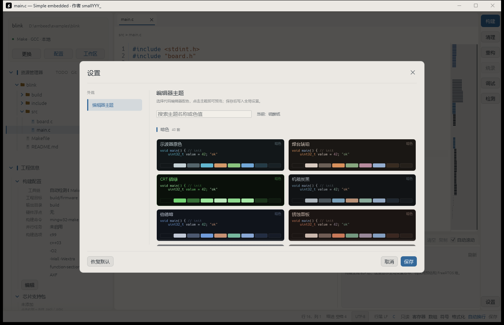
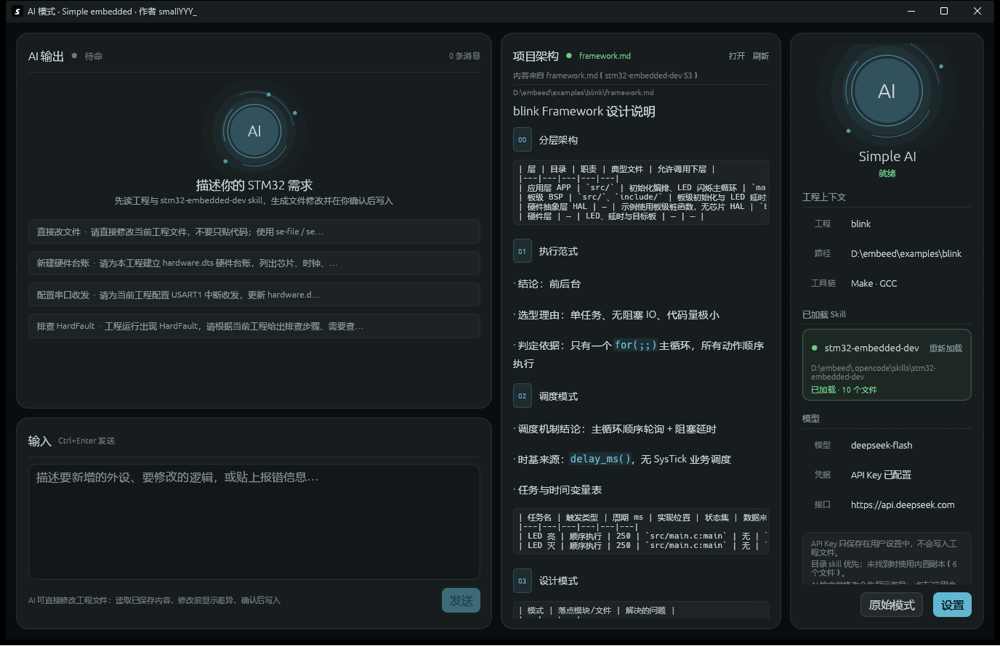

# Simple embedded 使用教程

这是一份从打开软件到完成第一次构建、烧录的完整教程。Simple embedded 的目标很简单：**工程文件夹就是工程**，你不需要先创建 `.eide` 文件、选择芯片或配置内存布局；构建与烧录配置保存在工程内 `.simple-embedded/settings.json`。

---

## 1. 启动软件

### 使用已构建的 exe

```powershell
& "D:\embeed\target\release\simple-embedded.exe"
```

双击 `target\release\simple-embedded.exe` 也可以。

### 安装到系统（推荐）

如果希望像普通软件一样从开始菜单启动，并在资源管理器里右键文件夹直接打开工程：

1. 打开 **配置**（`Ctrl+,`）→ **其他** → **系统集成**。
2. 点击 **安装到系统**。程序会安装到 `%LOCALAPPDATA%\Programs\SimpleEmbedded`，复制或链接自带工具链，并创建开始菜单快捷方式、Windows 应用列表卸载项和文件夹右键菜单。首次安装工具链较大时需要等待后台完成。
3. 在资源管理器中右键任意文件夹，选择 **用 Simple embedded 打开**。Windows 11 的默认精简菜单可能把它放在 **显示更多选项** 里。
4. 也可以直接运行 `simple-embedded.exe --install-system` 完成安装，运行 `simple-embedded.exe --uninstall-system` 卸载。

卸载也可以从 **Windows 设置 → 应用 → 已安装的应用 → Simple embedded → 卸载** 完成。卸载会移除右键菜单、快捷方式、`.se-workspace` 关联和安装目录，但保留 `%APPDATA%\SimpleEmbedded` 中的用户设置和最近工程。设置页的 **移除右键菜单与关联** 只移除系统集成，保留安装文件。

### 从源码运行

```powershell
cd D:\embeed
cargo run --release
```

启动时也可以直接带上工程目录，以及一个想顺便打开的文件：

```powershell
cargo run --release -- D:\firmware\my-board src\main.c
```

也可以直接传入工作区文件，程序会打开它指向的工程目录：

```powershell
cargo run --release -- D:\firmware\my-board\my-board.se-workspace
```

启动后，左上角显示构建卡片。未导入工程时：

- 名称显示为“未导入工程”
- 构建器显示“未配置”
- 点击 **导入**
- 或按 `Ctrl+O`
- 或直接把文件夹拖进窗口
- 或点 **工作区 → 打开工作区文件…** 选择 `.se-workspace` / `.code-workspace`

第一次打开时会自动记住这个工程；下次启动会尝试重新打开它。导入后按钮会变成 **更换 / 配置 / 工作区**。

---

## 2. 认识主界面

主界面分为四块：

```text
┌──────────────┬──────────────────────────┬────────────┐
│ 左侧：构建卡片 │ 中间：代码编辑             │ 右侧操作栏  │
│ 资源管理器    │                          │            │
│ 工程信息      ├──────────────────────────┤            │
│              │ 底部：构建输出             │            │
└──────────────┴──────────────────────────┴────────────┘
```

- 左侧构建卡片顶部显示当前工程名和完整路径
- 构建卡片在工具链和构建位置下方左对齐显示从 Makefile / `.uvprojx` 检测到的芯片型号
- 构建卡片里的 **配置** 用于修改构建命令，**更换** 用于切换工程，**工作区** 可生成/打开工作区文件并关联双击打开
- 工程构建与烧录配置保存在工程内 `.simple-embedded/settings.json`，换机器或重新打开工程不会丢失；Keil `.uvprojx` 不会被修改
- 资源管理器第一行是工程根目录，点击可展开/收起，下面才是工程内容
- 在文件或文件夹上右键可以新建文件/文件夹、粘贴、剪切、复制、重命名、删除、复制路径/相对路径、在文件资源管理器中显示；复制重名会自动生成“副本”名称，剪切和重命名会同步更新已打开的标签页与断点。删除前会弹出确认，存在未保存标签页时不会删除；删除 `.c` / `.cpp` 文件或目录后，会自动从 Makefile 的 `C_SOURCES` 移除对应条目
- 文件树较长时，拖动资源管理器与工程信息之间的分割线，可以调整两块区域的高度；位置会记住
- 拖动左栏右侧边缘，可以调整整个左栏的宽度
- 收起或展开工程信息时标题位置保持不变；文件树较短时标题紧跟最后一个文件，展开状态也会记住
- 文件树下方是“工程信息”，点击分组或列表整行可选中并收起/展开，选中行显示淡蓝色背景
- 工程信息中可查看构建配置、芯片支持包、输出目录、CPU、浮点、链接脚本、烧录配置、包含目录、库搜索目录和宏定义
- 工程信息 → 构建配置里的 **工具链** 只读显示，不能直接改；修改入口是 **配置 → 构建 → 工具链**（自动检测、Make GCC / Clang / AC5 / AC6、Keil MDK AC5 / AC6、Cargo、CMake）。配置里的 **自动检测** 先看工程根目录的 Cargo.toml / Makefile / CMakeLists.txt / `.uvprojx`，确定期望的构建系统，再查 PATH 和常见安装目录中的 make / cargo / cmake / UV4。CubeMX 同时生成 MDK-ARM 和 Makefile 时，Make 构建显示 Makefile 的目标/芯片/链接脚本，Keil 工具链显示 `.uvprojx` 的值；构建命令与所选工具链不一致时会出现黄色提示
- 构建配置里的 **构建选项 → 编辑** 分为全局选项、C/C++ 编译器、汇编器和链接器四个页面，页面内容会随工具链变化：GCC/Clang 显示 newlib-nano 浮点、LTO、函数分段；Keil AC5/AC6 显示 Use MicroLIB、Split Load/Store 和 Keil 链接器字段
- 只有 Make + GCC/Clang 工具链保存构建选项时才会按差异写回 Makefile；链接器输出格式选 `AXF` 后，重新构建会生成 `.axf` 副本。Keil 和 Make AC5/AC6 只写工程配置，不修改 `.uvprojx`
- **全局选项** 在 GCC/Clang 工具链下提供 newlib-nano 浮点支持开关：`printf / sprintf 支持 %f` 和 `scanf / sscanf 支持 %f`。勾选后 Makefile 工程会写入 `LDFLAGS += -u _printf_float` / `-u _scanf_float`，解决 `%f` 空白或打印 0 的问题；会增加几 KB 体积
- “芯片支持包”分组右侧的 **+** 可选择 Keil/CMSIS 的 `.pack` 或 `.pdsc`，文件会被复制到工程根目录；分组中显示包名、版本、厂商、设备和 SVD 数量
- 工程内没有单独 `.svd` 时，寄存器浏览器会直接读取支持包里的 SVD；支持包不会自动生成启动文件、链接脚本或烧录算法
- 工程信息底部的 **资源报告** 分组可以点击 **生成资源报告**（工作区菜单也可）：后台扫描芯片 / 内存 / SVD 外设 / `.ioc` 引脚、源码和头文件清单、链接脚本、软件组件、符号和调用图统计、构建和调试配置，并保存为工程根目录的 `<工程名>.resources.json`。报告只读工程，不会修改 Makefile、Keil 工程或链接脚本；使用已保存文件和当前索引，未保存的编辑不会进入清单。`warnings` 会说明缺失的 SVD、`.ioc`、固件或索引。报告是静态启发式结果，不能替代原理图、BOM 或实际电路检查
- 需要移除支持包时，在系统文件管理器中删除工程根目录下对应的 `.pack` / `.pdsc` 文件，再点资源管理器右上角的 **刷新**
- 包含目录、库搜索目录和预处理定义标题左侧也有折叠箭头，可单独收起
- 这些列表右侧有绿色 `+`，点击可直接添加一项；底部的 **批量编辑** 可一次修改全部内容
- 包含目录下方的 **自动检测包含目录** 只扫描 `.h` / `.hpp` / `.hh` / `.hxx` / `.inl` 头文件，跳过构建目录、隐藏目录和忽略目录，把每个头文件所在的父文件夹追加到包含目录；之前误加的只含 `.c` 的目录（如 `Core/Src`、`Drivers/.../Src`）会在这时被清理
- 包含目录下方的 **同步源文件到 Makefile** 会扫描工程里的 `.c` / `.cc` / `.cpp` / `.cxx`，把还没有加入的源文件追加到 Makefile 的 `C_SOURCES`（例如 `BSP/bsp_usart.c`）；`Drivers` / `Middlewares` / `CMSIS` 等供应商目录不会自动加入。修改前会自动备份，已打开且未保存的 Makefile 会拒绝写入
- Makefile 工程保存这些修改时会同步到 Makefile（修改前自动备份）；Keil `.uvprojx` 不会被修改
- 左侧点文件夹展开，点文件在中间打开
- 文件有修改时，Tab 上会出现黄色圆点，窗口标题也会标记为未保存
- 底部输出面板可切换 **构建输出 / 调试输出**，可以拖动顶部手柄调整高度；收起后也能直接向上拉出，高度会记住；也可以点标题左侧的 **收起/展开**
- 构建输出右侧的 **内存可视化** 读取 ELF 符号：全局变量分布（`.data` / `.bss`）、栈顶/栈预留/SP 使用预估、FreeRTOS 堆区；拖动中间分隔线调整宽度，面板高度与调试侧栏一致。调试暂停后会读取 SP 显示实时栈用量
- 链接失败时，如果日志里出现 `undefined reference to`，输出面板会追加一条提示，指出缺失的函数/符号，并提醒检查对应的 `.c` 是否加入 Makefile 的 `C_SOURCES`、函数是否实现、是否误加了 `static`。这类错误是链接阶段错误，不是头文件包含失败

---

## 3. 打开一个已有工程

假设你的固件目录是：

```text
D:\firmware\my-board
├── Makefile
├── src\
│   └── main.c
└── include\
    └── board.h
```

操作：

1. 点击左上角 **选择工程文件夹**
2. 选择 `D:\firmware\my-board`
3. 在左侧展开 `src`，点击 `main.c`

Simple embedded 会自动检查工程根目录：

| 根目录存在 | 自动使用的构建系统 |
| --- | --- |
| `Cargo.toml` | Cargo |
| `Makefile` / `makefile` / `GNUmakefile` | Make（`make`、`gmake` 或 Windows 的 `mingw32-make`） |
| `CMakeLists.txt` | CMake |

如果根目录没有这些文件，构建按钮会被禁用。点击左上角工程卡片里的 **配置**，手动填写命令即可；配置里也可以重新点击 **自动检测**。

> Simple embedded 只在工程内创建 `.simple-embedded/settings.json`（构建/烧录配置）和用户主动生成的 `.se-workspace`；不会创建 `.eide` 等专有格式，也不会修改 Keil `.uvprojx`。工程文件夹仍然可以直接提交到 Git 或拷贝给同事。

---

## 4. 编辑与保存

### 基础操作

- 点击左侧文件打开新 Tab
- 点击 Tab 切换文件
- 点 Tab 上的 `×` 或按 `Ctrl+W` 关闭文件
- 有未保存修改时，关闭前会弹出确认框
- `Ctrl+S` 保存当前文件
- `Ctrl+Shift+S` 保存所有文件

### 主题与外观

- 点击右侧操作栏底部的 **设置**，打开左上角带“设置”标题的窗口；第一个菜单是 **编辑器主题**
- 内置 **40 套暗色 + 10 套亮色，共 50 套**主题；搜索框可按主题名称或颜色值过滤
- 点击任一主题会立即预览整个软件：代码编辑器、文件树、侧栏、构建输出、菜单、按钮、状态栏和 Windows 标题栏都会一起换肤
- **保存** 后写入全局设置，下次启动保持；**取消**、右上角 `×` 或 `Esc` 会恢复打开窗口前的主题
- **恢复默认** 会选中“示波器原色”；暗色和亮色在列表中分组显示



### 编辑辅助

- 语法高亮：C/C++/ASM/Rust/Makefile/CMake/TOML/JSON 等
- Tab 缩进
- 左侧行号，当前行更亮；设置里可打开 **相对行号**
- 编辑区右侧的 **代码预览小地图** 可点击或拖动跳转，滚动时显示当前视口范围；设置中可关闭
- 缩进参考线在每级缩进位置显示，当前光标所在缩进层级会高亮；设置中可关闭
- 设置里可选 80 / 120 列 **换行标尺**
- 设置里可打开 **显示空白字符**，用点、箭头和折角显示空格、Tab 和换行
- 括号匹配：光标靠近 `() [] {}` 时自动高亮配对，`Ctrl+]` 跳到配对括号
- 书签：`Ctrl+F2` 在当前行添加/移除，`F2` 跳到下一个，`Shift+F2` 跳到上一个
- 撤销 / 重做 / 复制 / 粘贴使用 egui 编辑器默认快捷键
- `Ctrl+Shift+Enter` 进入 / 退出沉浸式编码模式：窗口切换为无边框全屏，隐藏标题栏、任务栏、左侧资源管理器与构建卡片、右侧操作栏、底部输出面板和状态栏，编辑器占满屏幕；右侧悬浮资源管理器可展开目录并选择文件，点标题栏三角可收起成一条标题栏、再次点击展开，关闭悬浮窗或再次按快捷键退出并恢复窗口
- 工具栏上的 **自动换行** 可切换长行折行
- `Tab` 插入缩进，`Shift+Tab` 减少缩进；选中多行时整块缩进 / 反缩进
- 回车自动保持当前行缩进，在 `{` / `[` / `(` 后额外增加一级
- 设置中可选择 **空格缩进** 和 **缩进宽度**（1–8）
- 设置中可开启 **自动保存**，停止输入指定毫秒后自动保存所有修改
- 工具栏 **只读** 可锁定当前文件，锁定后不能编辑、替换、切换编码或保存；再次点击恢复
- 工具栏 **格式化** 或 `Ctrl+Shift+I` 使用 clang-format 格式化当前 C/C++ 文件；可在设置中指定 clang-format 路径，或开启 **保存时 clang-format**
- 未安装 clang-format 时会提示安装 LLVM 或填写路径，不会阻止普通保存
- 资源管理器右上角 **Git** 或 `Ctrl+Shift+G` 打开 Git 状态：显示分支和已修改 / 新增 / 删除文件，点击文件直接打开
- 文件树里 `M` 为已修改、`U` 为未跟踪、`A` 为新增、`D` 为删除、`R` 为重命名；当前文件已修改的行在行号栏左侧显示黄色竖条
- Git 集成只读取本机 `git` 命令状态，不自动提交、不弹出凭据窗口
- 资源管理器右上角 **TODO** 或 `Ctrl+Shift+T` 扫描工程中的 `TODO` / `FIXME` / `HACK` / `NOTE` 注释，可按类型过滤，点击跳到对应行
- 工具栏 **符号** 或 `Ctrl+Shift+O` 搜索 C/C++ 函数、结构体、宏和汇编标签，支持按名称或路径过滤，点击跳转
- 单击 `.bin` / `.elf` / `.axf` 等二进制文件时，会在中央编辑器打开只读十六进制 + ASCII 标签页；可滚动查看，不提供保存和格式化。右键仍可打开独立十六进制窗口
- 文件树右键 **十六进制查看**，或 `Ctrl+Shift+H` 查看当前文件；显示偏移、十六进制和 ASCII，可直接把字节生成 C 数组
- 工具栏 **数组** 或 `Ctrl+Shift+A` 生成 C 数组：优先使用选中内容，否则使用当前文件；可修改变量名、十六进制/十进制和每行字节数，并一键复制
- 工具栏 **寄存器** 或 `Ctrl+Shift+R` 浏览外设寄存器：优先解析工程内 `.svd` 文件，其次读取芯片支持包里的 SVD，否则列出头文件中 `*_BASE` / `*_ADDR` / `*_ADDRESS` 宏及其地址；支持按名称、地址或说明过滤，点击跳到定义行
- 右侧 **调试** 按钮或 `F5` 启动调试；首次启动会先停在 `main` 并自动打开入口文件，之后编辑器右上角会出现调试浮层，用图案按钮继续、暂停、停止、下一步、单步和跳出；目标运行时主按钮会从三角形变成 **II** 暂停图案，状态显示“运行中”；点击或再按 `F5` 请求暂停。浮层最左侧的 **准心** 按钮可随时回到当前执行行，即使已经切换到其他文件。点击行号左侧空白或按 `F9` 切换当前行断点，快捷键分别是 `F10` 下一步、`F11` 单步、`Shift+F11` 跳出、`Shift+F5` 停止。程序暂停或单步后会更新执行标记：自动打开所在文件、滚动到当前执行行，并用黄色箭头和整行浅黄底标出
- 调试输出右侧的 **变量 / 寄存器 / 外设** 页可以搜索寄存器、添加变量或表达式并自动刷新；**外设** 页解析 SVD，按“外设 → 寄存器 → 位域”折叠显示，例如 `ADC1` → `ISR` / `CR` / `DR`，展开寄存器可看到每个位域的名称、位范围和值。目标暂停时，寄存器或位域右侧的“改”可以写入新值；位域修改会读-改-写整个寄存器。没有 SVD 时会显示头文件宏回退和 **导入 SVD** 按钮，点击后把 `.svd` 复制到工程根目录并立即刷新。输入过滤词会自动展开匹配外设。调试程序默认在 `build/`、`Debug/`、`Release/`、`out/` 中寻找最新的 ELF/AXF/EXE，也可在设置里手动填写或点 **浏览** 选择
- ARM 目标会复用“工程信息 → 烧录配置”里的 OpenOCD 或 pyOCD 参数：程序会自动启动 GDB server，再用 arm-none-eabi-gdb 连接、加载 ELF/AXF 并继续运行。主机 EXE 则使用普通 gdb
- 设置 **调试** 页的 gdb 路径可以点 **浏览** 选择 `arm-none-eabi-gdb.exe`，也可以点 **自动检测**；填 `...\bin` 目录或完整的 exe 路径都可以
- 如果日志出现 `error 193` 或 `not a valid Win32 application`，通常是用了 MinGW 的主机 gdb 去运行 ARM 程序。请在设置中重新选择 arm-none-eabi-gdb
- 调试输出显示在底部输出面板的 **调试输出** 页，可以在最下方输入 gdb 命令（如 `info locals`、`bt`、`continue`）并查看结果
- 右侧操作栏的 **检测** 按钮在工程打开后即可用。未启动调试时打开 **静态检测**，扫描工程内 `.c/.h`：数组常量下标越界、`strcpy`/`strcat`/`memcpy` 常量长度超过目标数组、`gets`/`sprintf`、重复 `free`、可疑 `malloc` 字节数和返回数组名。启动调试后打开 **动态监测**，可以输入变量名或地址表达式，选择写入 `watch`、读取 `rwatch` 或读写 `awatch` 添加硬件 watchpoint；命中后目标自动暂停并记录新旧值。Cortex-M 通常支持 2-4 个硬件 watchpoint，数量超限时 GDB 会报错或退化为软件 watchpoint（界面会标记“软件”）。静态扫描是启发式检查，复杂宏、动态下标和运行时数据问题仍需 ASAN/Valgrind
- 勾选“调试时自动启动动态监测”后，已保存的 watchpoint 会在目标停在 `main` 后再重新启用，避免启动代码清 `.bss` 时误命中；OpenOCD 把命中报告为 `SIGTRAP` 时，程序会查询创建时保存的旧值和当前值，仍记录旧值 → 新值、位置和调用栈
- 粘贴多行文本时会自动对齐到当前行缩进，并保留粘贴内容的相对缩进
- 按住 `Ctrl+Alt` 在编辑器中按住鼠标左键拖动，可进行矩形列选择；`Ctrl+C` 复制、`Delete/Backspace` 删除、直接输入会替换矩形区域
- 多光标：按住 `Alt` 点击添加光标；`Ctrl+Alt+↑/↓` 在上下行同一列添加光标；`Ctrl+D` 选中当前词并添加下一个匹配；`Esc` 清除所有次级光标。输入、`Backspace/Delete`、`Enter`、`Tab` 和粘贴会同时作用于所有光标/选择，`Ctrl+C` 复制全部选择。普通点击或方向键移动主光标时会清除次级光标
- 代码折叠：鼠标经过可折叠行时，行号右侧出现下箭头，点击折叠；折叠后隐藏起始行和结束行之间的块内行，结束行（右花括号）保留可见，点击行号右侧右箭头恢复；鼠标经过折叠箭头时变为手形，折叠和展开时保持当前滚动位置。也可用 `Ctrl+Shift+[` 折叠当前块、`Ctrl+Shift+]` 展开全部；行号栏保留源文件行号，可见行仍可直接编辑
- 撤销/重做：`Ctrl+Z` 撤销，`Ctrl+Shift+Z` 或 `Ctrl+Y` 重做，支持跨文件；最大深度在 **配置 → 其他 → 撤销栈深度** 设置，默认 64 次
- 右键标签页可 **关闭 / 关闭其他 / 关闭右侧标签页 / 关闭已保存 / 全部关闭**；**保存**、**另存为**；**复制路径 / 复制相对路径 / 复制痕迹导航路径**；**在文件资源管理器中显示**、**在资源管理器视图中显示**；以及 **向右拆分**、**拆分和移动 → 向上拆分**、**取消拆分**。两个拆分窗格都可编辑，点击窗格即可切换
- 标签页下面是文件路径面包屑（如 `Core > Src > main.c`），从工程根目录开始
- 最底部状态栏显示当前行/列、缩进、编码、行尾和语言，并集中放置只读、寄存器、数组、符号、格式化、自动换行、保存按钮
- 输入至少 2 个字符后会自动在光标旁弹出补全框；输入 `.` 或 `->` 时补全结构体成员。`↑` / `↓` 选择，`Enter` / `Tab` 插入，`Esc` 关闭；`Ctrl+Space` 可随时手动打开
- 把鼠标停在函数名、变量名、结构体或宏上，会显示声明签名、上方注释以及返回值 / 类型；提示跟随鼠标显示，跨文件函数会使用轻量符号索引查找声明。提示下方继续显示 **调用关系**（左侧调用者、右侧被调用者的框图，以及调用树）和 **引用** 树（按文件分组，显示函数、变量、宏和结构体的使用位置）。配置 → 其他 的 **变量 / 函数悬停提示** 可以关闭该功能
- 宏诊断：同一文件内同名 `#define` 重复会显示红色波浪线；配置 → 其他 打开 **宏重复值提示（黄色波浪线）** 后，`PWM1PIN` / `PWM2PIN` / `PWM3PIN` 这类宏族使用相同替换值时会显示黄色波浪线。C 语言本身允许不同宏名映射到相同值，所以它是可选的复制粘贴提示；供应商头文件不参与该检查
- 成员补全是轻量解析，不做完整 C/C++ 语义分析；刚修改的 struct 定义需要先保存，复杂宏展开、模板、继承或函数返回类型可能不会出现在候选里
- 悬停调用/引用树基于已保存文件的文本索引，不是完整语义分析：同名 `static` 函数会合并，函数指针调用、宏展开、重载、继承和条件编译无法准确解析；每个符号最多保留 24 处引用，悬停只列出前 3 个文件各 2 处。注释、字符串和 `build` / `Debug` / `Release` / `out` / `target` 等生成目录会被排除；保存文件后索引会自动在后台更新
- 多光标支持 Alt+点击、Ctrl+Alt+↑/↓、Ctrl+D；方向键只移动主光标并清除次级光标，不支持 VS Code 的多光标同时移动或 Ctrl+U 回退光标。Ctrl+Alt+左键仍提供单一矩形列选择。代码折叠只识别 C 风格大括号块，折叠时只隐藏块内行，可见行仍可编辑，折叠状态不持久化
- `F12` 跳到当前标识符的定义、`Shift+F12` 查找所有引用；启用 clangd 后优先使用语义分析，未启用时回退到工程符号索引 / 全工程搜索

#### clangd 语言服务（可选）

1. 安装 LLVM（自带 `clangd`）或 VS Code 的 clangd 扩展。程序会自动在 PATH、LLVM 安装目录和 VS Code / Cursor 扩展目录中查找 clangd。
2. 打开 **配置 → 其他 → 语言服务**，勾选“启用 clangd”；如果没有自动找到，用“浏览”选择 `clangd.exe`，保存设置。
3. 程序会按工程信息里的包含目录、宏定义，以及根 Makefile 的 `CPU` / `FPU` / `FLOAT-ABI` 生成 `compile_commands.json`（位于 `%APPDATA%\SimpleEmbedded\clangd\<hash>\`）。这样 `<stdint.h>`、HAL 头文件和 `--target=arm-none-eabi` 会按真实的 ARM 编译参数解析，而不是退回主机编译器。
4. 支持 `F12` 跳转定义、`Shift+F12` 引用列表、悬停类型 / 声明、自动补全，以及 `Ctrl+Shift+F2` 或底栏 **重命名** 按钮重命名符号；引用窗口中的位置可以直接点击跳转。
5. 修改包含目录或宏定义后保存设置，会重新生成编译数据库并重启 clangd。没有安装 clangd 时，补全/跳转/引用自动回退到轻量符号索引。
- 查找 / 替换：`Ctrl+F` 在编辑器右上角弹出浮层，`Ctrl+H` 直接展开替换；`Aa` 区分大小写，`ab` 全字匹配，`.*` 正则；`F3` / `Shift+F3` 上下一个
- 查找浮层左侧的下拉箭头展开/收起替换行；`AB` 保留大小写；右侧 `≡` 打开全工程搜索；`Alt+C` / `Alt+W` / `Alt+R` / `Alt+P` 分别切换大小写、全字、正则和保留大小写
- 查找匹配会在编辑器中高亮，当前匹配使用不同底色
- `Ctrl+G` 打开与查找浮层同宽的跳转行浮层，输入 1 到当前文件总行数之间的数字后回车；提示文字使用普通次要色
- 全工程搜索：`Ctrl+Shift+F` 或查找浮层的 `≡`；支持大小写 / 正则，结果显示文件、行号和预览，点击直接跳转
- 资源管理器默认遵循工程根目录的 `.gitignore`；设置里可以关闭，或用分号追加额外忽略规则（如 `build/; *.tmp`）
- 构建日志中带 `文件:行:列` 的错误 / 警告行可以直接点击，跳转到对应代码行
- 有错误的行在行号栏右侧显示红色竖条，警告显示黄色竖条
- 输出面板标题栏可过滤 **全部 / 错误 / 警告**
- 设置里可以调整代码字号，`Ctrl+=` / `Ctrl+-` 也可以快速缩放
- 打开和保存时会保持原来的 CRLF / LF 行尾
- 自动识别 UTF-8 / GBK；工具栏编码下拉可切换，保存时按所选编码写回
- 读取和保存 UTF-8 文件，保留 UTF-8 BOM（如果有）

### 还没保存时直接构建？

不用担心：点击 Build / Clean / Rebuild / Flash 之前，编辑器会自动保存所有未保存文件。

---

## 5. 构建、清理与重新构建

以 `Makefile` 工程为例，自动检测通常会得到：

- Build：`mingw32-make`（Windows）
- Clean：`mingw32-make clean`
- Rebuild：`mingw32-make clean && mingw32-make`

点击右侧操作栏的 **构建** 或按 `Ctrl+B`。

构建期间：

- UI 不会冻结，可以继续切文件或编辑
- 右侧操作栏会显示 **停止**
- 输出面板实时显示命令的 stdout / stderr
- 含 `error` 的行显示为红色，含 `warning` 的行显示为黄色
- 同时支持编译器的 ANSI 颜色

构建结束后，底部会显示：

- 构建成功：绿色
- 构建失败：红色，并显示退出码
- 被停止：黄色

输出面板标题右侧还可以：

- **清空**：清掉当前日志
- **复制**：把全部日志复制到剪贴板
- **自动滚动**：关闭后可以回看之前的日志
- **停止**：强制结束 Windows 进程树

### 修改构建命令

点击左上角构建卡片的 **配置**，或按 `Ctrl+,`：

- **Build**：例如 `make -j8`、`cargo build --release`
- **Clean**：例如 `make clean`
- **Rebuild**：例如 `make clean && make`
- **Flash**：烧录命令，可留空

点击 **自动检测** 可以重新读取根目录的构建文件。

### 并行构建

在 **配置 → 构建** 中设置 **并行任务数**：

- `0`：不启用，保持原命令行为
- `N > 0`：Make 使用 `MAKEFLAGS=-jN`，Cargo 使用 `CARGO_BUILD_JOBS=N`，CMake 使用 `CMAKE_BUILD_PARALLEL_LEVEL=N`
- 点 **使用 CPU 核心数** 可以填入本机逻辑核心数
- 如果 Build / Clean / Rebuild 命令里已经写了 `-j`、`--jobs` 或 `--parallel`，不会再重复注入
- 只影响 Build / Clean / Rebuild，不影响 Flash
- 远程 SSH 构建会在远端 shell 中设置同样的环境变量；自定义脚本需要自己处理并行参数

### 构建设置

配置窗口顶部有 **构建 / 编辑器 / 调试 / 其他** 四个页签，点击后下方只显示对应页面。

在 **构建** 页可以：

- 在 **工具链** 下拉里选择自动检测、Make GCC / Clang / AC5 / AC6、Keil MDK AC5 / AC6、Cargo、CMake、MicroPython 或自定义。工程信息里的工具链是只读显示，只能在保存这里的设置后改变。
- 点 **自动检测**：先看工程根目录的 Cargo.toml / Makefile / CMakeLists.txt / `.uvprojx`，确定期望的构建系统；再查 PATH 和常见安装目录中的 make / cargo / cmake / UV4。识别结果会填入工具链、Build/Clean/Rebuild 命令和工具链路径。
- 配置本地或远程 SSH 构建、Build/Clean/Rebuild/Flash 命令和并行任务数。
- **工具链路径** 位于并行任务数下方，右侧多行输入框高度约为 Build 输入框的三倍；每行填一个目录，构建时会加到 `PATH` 前面，适合编译器、make、Keil UV4 不在系统 `PATH` 的情况。旧版本的“构建工具链”页已移除；发布版自带的 `tools/` 目录仍会自动优先使用。

### MicroPython / ESP32 串口

1. 在 **配置 → 构建 → 工具链** 中选择 **MicroPython**。如果工程根目录只有 `main.py` / `boot.py`，打开工程时也会自动识别为 MicroPython。
2. 工具链下面的构建命令区域会切换成 **串口连接**：
   - **串口端口**：点击下拉框可选择检测到的串口，也可以在弹出的“手动输入端口”里直接填写 `COM3` 或 `/dev/ttyUSB0`
   - **波特率**：默认 `115200`，可选 `9600`、`74880`、`115200`、`230400`、`460800`、`921600` 等常用速率
   - **自动检测**：扫描当前串口，优先选择 ESP32 / CP210x / CH340 / FTDI 等 USB 串口；没有识别到设备时会提示检查 USB 数据线和驱动
3. 点击 **保存** 后，端口和波特率写入工程的 `.simple-embedded/settings.json` 的 `serial` 字段。
4. 右侧操作栏在 MicroPython 模式下切换为：
   - **运行**：把当前 `.py` 内容上传为板上的 `main.py`，然后发送软复位；设备会运行新的 `main.py`，程序里的 `while True` 也会继续运行
   - **上传**：把当前 `.py` 按原文件名写入开发板（例如 `main.py`、`boot.py` 或 `sensor.py`），不自动复位
   - **复位**：发送 Ctrl-D 软复位，运行板上已有的 `main.py`
   上传/运行结果和串口启动日志显示在底部输出面板的 **MicroPython 输出** 页；运行前不需要手动编译，编辑器里的未保存内容会直接使用。注意 **运行始终把当前内容写成 `main.py`**；如果要更新 `boot.py` 或其他模块，请用 **上传** 后再复位或 `import`。
5. 左栏的 **工程信息** 在 MicroPython 模式下会替换为 **芯片文件**：
   - 展开后会读取开发板根目录和最多两层子目录，显示路径、目录标记和文件大小；读取操作会暂停板上正在运行的程序
   - 点 **刷新** 重新读取；串口未配置或读取失败时会在面板内显示原因
   - 点击文件会把芯片内容下载到工程的对应相对路径并打开到编辑器；同名文件会生成“副本”后缀，不会覆盖本地文件
   - 下载时会记住芯片原路径；之后点 **上传** 会优先写回原路径，即使本地打开的是“副本”文件。修改 `main.py` 后点 **运行** 则始终写回板上的 `main.py`
   - 列表读取、单文件读取、运行 / 上传 / 复位失败或串口被占用时，错误会同时显示在芯片文件面板和 **MicroPython 输出**
6. 当前上传/读取上限为 128 KB，尚未内置交互式 REPL 或目录上传。Build / Clean / Rebuild / 检测按钮在 MicroPython 模式下隐藏，避免误执行 C 工具链命令。

### 烧录 MicroPython 固件

如果开发板还是空白 Flash 或不是 MicroPython 固件，可以直接在编辑器里烧录：

1. 安装 esptool：`pip install esptool`（支持 4.x / 5.x），确保 `esptool` 在 PATH 中，或在配置里浏览到 `esptool.exe`。
2. 从 MicroPython 官网下载对应开发板的**合并固件 `.bin`**。
3. 在 **配置 → 构建 → MicroPython → 串口连接 → MicroPython 固件烧录** 中填写：
   - 固件文件：合并后的 `.bin`
   - esptool：程序名或完整路径；可点 **自动检测**
   - 芯片：ESP32 / ESP32-S2 / ESP32-S3 / ESP32-C3 / ESP32-C6 / ESP32-H2
   - 烧录地址：ESP32 / ESP32-S2 默认 `0x1000`，S3/C3/C6/H2 默认 `0x0`
   - 可选 **烧录前整片擦除** 和 **写入校验**
4. 保存配置后，点击右侧操作栏的 **固件**，确认后开始烧录。
5. 烧录输出显示在 **MicroPython 输出**；成功后重新点击 **刷新** 读取芯片文件，或直接写 `main.py` 并点 **运行**。

编辑器会先探测 esptool 主版本：esptool 4.x 使用 `write_flash` / `erase_flash`，取消 **写入校验** 时传 `--no-verify`；esptool 5.x 使用 `write-flash` / `erase-flash`，写入后自动校验，取消勾选不会关闭校验。

固件烧录会覆盖开发板上的 MicroPython 固件；勾选整片擦除会清除板上已有 `.py` 文件。编辑器不会自动下载固件，需要自己准备对应芯片的 MicroPython `.bin`。

开发板接线时注意使用支持数据传输的 USB 线；部分 ESP32 开发板需要 CP210x 或 CH340 驱动，安装驱动后重新点击 **自动检测**。

在 **其他** 页可以：

- 开关 **变量 / 函数悬停提示**（默认开启）
- 开关 **宏重复值提示（黄色波浪线）**（默认关闭）。开启后，`PWM1PIN` / `PWM2PIN` / `PWM3PIN` 这类宏族使用相同替换值时会显示黄色波浪线；同名宏重复始终是红色波浪线
- 设置 **撤销栈深度**（默认 64，最大 64），控制跨文件撤销 / 重做保留的编辑次数
- **系统集成**：安装到系统 / 移除右键菜单与关联；安装后会添加开始菜单快捷方式、Windows 应用列表卸载项，以及资源管理器文件夹右键 **用 Simple embedded 打开**
- 控制是否显示隐藏文件、输出是否自动滚动、是否遵循 `.gitignore`，以及追加忽略规则

发布版可以直接把工具链放在程序同级的 `tools/` 目录，应用默认优先使用它，用户导入 Makefile 工程后无需配置 `PATH`。仓库提供打包脚本：

```powershell
cargo build --release
powershell -ExecutionPolicy Bypass -File scripts\package-tools.ps1
```

脚本会把 release exe、当前使用的 ARM GCC 和 make 复制到 `dist\simple-embedded\`，生成的目录可以直接压缩分发给其他用户。`dist/` 和 `tools/` 不进入 Git。

设置和自动备份位于：

```text
%APPDATA%\SimpleEmbedded\settings.json
%APPDATA%\SimpleEmbedded\backups\
<工程目录>\.simple-embedded\settings.json
```

全局设置保存最近工程、编辑器偏好等；每个工程的构建、烧录、C/C++ 和调试配置保存在工程内 `.simple-embedded/settings.json`。打开工程时优先读取该文件，旧版本保存在用户目录里的每工程配置会在打开工程时自动迁移。Makefile 工程在保存构建选项或 C/C++ 属性时还会同时写入 Makefile；Keil `.uvprojx` 不会被修改。修改后点击 **保存** 才会生效。

---

## 6. 配置烧录

烧录**始终在本地工程目录执行**，这样 J-Link / ST-Link 等工具可以直接访问 USB；即使构建目标选的是远程 SSH，也不会把烧录命令发到远端。

在左侧 **工程信息 → 烧录配置** 中配置：

- **烧录工具**：下拉选择 **自定义命令**、**OpenOCD** 或 **pyOCD**。
- **OpenOCD**：
  - **工具路径**：下拉会列出 PATH、Program Files、PlatformIO 等位置的 OpenOCD；也可以点 **浏览** 选择 `openocd.exe`。
  - **程序文件**：默认 `${ExecutableName}.hex`，会自动解析到当前工程最新的构建产物；也支持 `${ProjectName}`、`${workspaceFolder}`、`${workspaceRoot}`。
  - **芯片配置**：例如 `stm32f1x.cfg`。只写文件名时会自动补成 `target/stm32f1x.cfg`。
  - **接口配置**：预设下拉包含 ST-Link、CMSIS-DAP / DAPLink、J-Link、XDS110、ULINK 等；也可以直接输入自定义配置（只写文件名时会自动补成 `interface/...`）。旁边的 **自动检测** 会通过 USB VID 识别已连接的探针并填入配置。默认不再自动选择 `stlink.cfg`，使用 DAPLink 时请在下拉中选择或点自动检测。
- **pyOCD**：
  - **工具路径**：下拉会检测 PATH 和 Python Scripts 目录；也可以点 **浏览** 选择 `pyocd.exe`。
  - **目标芯片**：例如 `stm32f103xb`。从工程芯片名推断时会自动转小写。
  - **Pack**：可选；工程根目录有 `.pack` 时会优先填入，也可以浏览选择其他 CMSIS Pack。
  - **程序文件**：默认 `${ExecutableName}.hex`，支持与 OpenOCD 相同的变量。
- 点分组里的 **编辑** 可以打开烧录配置弹窗，修改全部字段并查看最终命令预览。
- 点 **内存布局...**（或 `Ctrl+Shift+M`）打开 Cortex-Debug 风格的内存布局：左侧 Read/Write 为 IRAM1/2、RAM1-3（Default、起始地址、大小、NoInit），右侧 Read/Only 为 IROM1/2、ROM1-3（Default、起始地址、大小、启动），底部显示 RAM Total / ROM Total。打开时优先读取工程链接脚本，其次读取匹配芯片支持包的 `<memory>` 信息；保存后写入工程配置，不会自动改写链接脚本。`.bin` 会用下载起始地址，`.hex` / `.elf` / `.axf` 使用文件内记录的地址。
- 构建成功后，构建输出标题栏会显示类似 **Flash 2.8 KB / 64.0 KB (4%) · RAM 1.5 KB / 20.0 KB (8%)** 的占用摘要；没有 `size` 输出时会直接解析 ELF 段大小。
- **自定义命令**：点 **编辑**，或先把烧录工具切回 **自定义命令**，再打开 **配置 → 构建** 的 Flash 行，填写完整命令，例如：
  ```text
  JLink.exe -CommanderScript flash.jlink
  ```

OpenOCD / pyOCD 找不到程序文件时会直接报错，不会自动构建。正确顺序仍然是 **先构建成功，再烧录**。

pyOCD 的最终命令类似：

```text
pyocd flash -t stm32f103xb build/firmware.hex
```

如果使用工程里的支持包，会自动附加：

```text
pyocd flash -t stm32f103xb --pack Keil.STM32F1xx_DFP.pack build/firmware.hex
```

ST-Link、STM32CubeProgrammer、pyOCD、J-Link、Keil、`.bin` 地址、PATH 配置和常见错误，见单独的详细教程：

**[docs/FLASH.md](FLASH.md)**

> 当前版本没有内置 J-Link MCP 客户端。自定义命令、OpenOCD 和 pyOCD 都是本地执行，因此也可以接任意封装脚本。

---

## 7. 远程 SSH 构建

适合同一套代码在 Linux 虚拟机里编译。Simple embedded 直接调用系统 OpenSSH。

### 前置条件

1. 本机已经安装 `ssh`（Windows 10/11 自带 OpenSSH 客户端）
2. 能免密登录：
   ```powershell
   ssh -o BatchMode=yes user@192.168.1.20 true
   ```
   如果这条命令不需要密码，就配置好了。
3. 虚拟机上已经有工程目录，例如 `/home/user/firmware`

### 在 Simple embedded 中配置

打开 **配置 → 构建**：

1. 构建位置选择 **远程 SSH**
2. 填写：
   - SSH 主机：`user@192.168.1.20` 或 `~/.ssh/config` 中的别名
   - SSH 端口：默认 `22`
   - 远程目录：`/home/user/firmware`
3. 命令仍然填 Make/Cargo 命令，例如 `make -j8`
4. 保存后点击构建

实际执行逻辑类似：

```text
ssh -o BatchMode=yes user@host "cd '/home/user/firmware' && make -j8"
```

注意：

- 必须提前配置 SSH key，远程模式不支持交互式密码输入
- 右侧操作栏的 **停止** 会结束本地 `ssh` 进程；远端编译进程是否退出取决于远端 shell/环境
- Flash 仍在本地执行；远程构建产物需要你自己同步回本地再烧录

---

## 8. 设置与持久化

全局设置文件位置：

```text
%APPDATA%\SimpleEmbedded\settings.json
```

里面保存：

- 最近工程列表
- 代码字号
- 自动换行
- 输出自动滚动
- 是否显示隐藏文件
- 旧版本每工程配置的迁移缓存

工程自己的构建与烧录配置位于：

```text
<工程目录>\.simple-embedded\settings.json
```

这是普通 JSON，保存构建、烧录、C/C++ 属性和调试配置（`debug.program`、`debug.gdb_path`），可以手改，也可以和源码一起提交。打开工程时优先使用它；旧版本的用户目录配置会自动迁移。

构建卡片的 **工作区** 菜单可以生成 `<工程名>.se-workspace`。文件内容是 VS Code 风格的 `folders` 字段，生成时会把 `.se-workspace` 关联到当前程序，之后双击即可打开工程。移动程序后重新点一次“生成并关联工作区文件”即可更新关联。

删除全局设置文件即可恢复首次启动状态；删除工程的 `.simple-embedded` 目录会清除该工程的本地配置。

---

## 9. 用自带示例试一遍

仓库包含一个可以直接编译的示例：

```powershell
& "D:\embeed\target\release\simple-embedded.exe" "D:\embeed\examples\blink" "D:\embeed\examples\blink\src\main.c"
```

然后：

1. 左侧应能看到 `include`、`src`、`Makefile`
2. 点击 `src/main.c`
3. 按 `Ctrl+B`
4. 底部应显示：

```text
▶ 构建 · mingw32-make
cc -std=c11 -Wall -Wextra -O2 -Iinclude src/main.c src/board.c -o build/firmware.exe
构建完成 · 用时 ...
```

前提是 `gcc` 和 `mingw32-make` 在 `PATH` 中。Windows 上通常来自 MinGW：

```text
C:\complier\mingw64\bin
```

可以在 PowerShell 里验证：

```powershell
gcc --version
mingw32-make --version
```

---

## 10. 快捷键速查

| 快捷键 | 功能 |
| --- | --- |
| `Ctrl+O` | 打开工程文件夹 |
| `Ctrl+S` | 保存当前文件 |
| `Ctrl+Shift+S` | 另存为 |
| `Ctrl+K S` | 保存全部文件 |
| `Shift+Alt+C` | 复制完整路径 |
| `Shift+Alt+R` | 在文件资源管理器中显示 |
| `Ctrl+B` | Build |
| `Ctrl+Shift+B` | Rebuild |
| `Ctrl+W` | 关闭当前 Tab |
| `Ctrl+,` | 打开配置 |
| `Ctrl+=` / `Ctrl+-` | 放大/缩小代码字号 |
| `Ctrl+Shift+Enter` | 进入 / 退出沉浸式编码模式 |

---

## 11. 常见问题

### 提示 `make` / `mingw32-make` 找不到

把 MinGW 的 `bin` 目录加入系统 `PATH`，然后重新启动 Simple embedded：

```powershell
where.exe mingw32-make
```

如果找不到，安装 MinGW-w64，或把 Build 命令改成你实际使用的 make 程序。

### 清理时报 `rm` 找不到 / `CreateProcess failed`

这是 POSIX 风格 Makefile 在 Windows 上缺少 Unix 工具导致的。新版本运行本地 Make 构建时会自动寻找 Git for Windows、MSYS2 或 Cygwin 的 `usr\bin` 并加入 PATH。

如果仍然失败，可以在 **配置 → 构建 → 工具链路径** 里填入对应的 `usr\bin` 目录，或在工程 `.simple-embedded/settings.json` 的 `build.extra_paths` 中手动添加，例如：

```text
D:\Program Files\Git\usr\bin
```

### 自动检测不到构建系统

确认工程根目录直接存在 `Makefile`、`Cargo.toml` 或 `CMakeLists.txt`。如果构建脚本在子目录，打开配置手动填写：

```text
cd firmware && make
```

（在 Windows 本地模式下命令会通过 `cmd /S /C` 执行，因此 `&&`、`cd` 都可以用。）

### 日志太长，右边被截断

当前日志采用固定行高虚拟化显示，超长行会横向裁剪。可以：

- 把鼠标悬停在长行上查看完整内容
- 点击输出面板的 **复制**，粘贴到文本编辑器里查看全部日志

### SSH 提示 `Permission denied`

先在本机终端测试：

```powershell
ssh -o BatchMode=yes user@host true
```

如果仍然要求输密码，说明 key 未配置成功。检查 `%USERPROFILE%\.ssh\id_ed25519.pub` 是否已加入远端 `~/.ssh/authorized_keys`。

### 保存失败

编辑器只支持 UTF-8 文本文件，且限制为 16 MB。保存失败通常是：

- 文件只读
- 文件被其他程序占用
- 路径权限不足

### 修改没有生效

设置需要点击 **保存**；构建前会自动保存所有未保存的源码 Tab。构建使用的是磁盘上的文件。

---

## 12. 从源码开发

```powershell
cd D:\embeed
cargo fmt --all
cargo test
cargo clippy --all-targets -- -D warnings
cargo run --release
cargo build --release
```

生成文件：

```text
target\release\simple-embedded.exe
```

项目结构与设计取舍见根目录的 `README.md` 和 `AGENTS.md`。

---

## 13. 动态监测（watchpoint）

动态监测需要调试会话：在 **检测 → 动态监测** 输入变量名或地址表达式，选择写入 / 读取 / 读写，目标访问该位置时会暂停并记录：

可以追踪全局 / 静态变量、结构体成员、数组元素、指针解引用和固定地址；适合定位“变量被谁改掉”“谁在读这个标志”“状态从哪条路径切换”。每次命中记录：

- 本地时间（精确到毫秒）
- 旧值 → 新值
- GDB 停止位置（谁改变了它）
- 调用栈（谁调用了它）

勾选 **调试时自动启动动态监测** 后，启动调试会自动打开面板并重新启用已保存的 watchpoint。Cortex-M 通常只有 2–4 个硬件比较器；数量不够时 GDB 可能退化为较慢的软件 watchpoint。优化后的变量、内联函数和高频写入会让记录不完整。

完整操作、示例和常见问题见：

**[docs/DYNAMIC.md](DYNAMIC.md)**

---

## 14. AI 模式

AI 模式把编辑器切换成三栏工作台，用于让兼容 OpenAI 接口的模型结合当前 STM32 工程和 `stm32-embedded-dev` skill 生成代码方案。



### 进入和退出

- 右侧操作栏最底部、**设置** 上方点击 **AI模式**，或按 `Ctrl+Alt+A`。
- 也可以从命令行直接进入：`simple-embedded.exe --ai D:\firmware\my-board`。
- 进入时先在编辑器上叠加雾气，整个窗口淡出并露出桌面；随后两颗流星分别落到左上输出面板和右侧工作台的 AI 图标上，三个面板从图标附近依次展开。动画只影响画面，不修改工程。Windows 使用分层窗口实现桌面透视；如果系统禁用透明/合成效果，窗口会保持不透明，只保留雾化和展开动画。
- 右侧面板右下角点击 **原始模式** 返回编辑器；再次按 `Ctrl+Alt+A` 也可以切换。

AI 模式由三个圆角面板组成：

```text
┌──────────────────────────────┬──────────────────┐
│ AI 输出                      │ AI 工作台         │
│ 聊天记录 / 代码块 / 复制      │ 工程上下文        │
├──────────────────────────────┤ Skill 状态        │
│ 输入                         │ 模型信息          │
│ Ctrl+Enter 发送              │ 原始模式 / 设置   │
└──────────────────────────────┴──────────────────┘
```

### 第一次配置

1. 进入 AI 模式后，点击右侧面板右下角的 **设置**。
2. 填写 **API Key**、**API 地址** 和 **模型名称**。
3. 默认地址是 `https://api.deepseek.com/v1`，默认模型是 `deepseek-chat`；也可以填其他 OpenAI 兼容服务，例如自建网关或本地模型服务。
4. 点击 **保存**。设置保存在用户目录的 `%APPDATA%\SimpleEmbedded\settings.json`，不会写入当前工程。
5. 如果接口返回错误，错误信息会直接显示在 AI 输出的聊天记录里，不会覆盖工程文件。

API Key 以明文保存在用户设置中，请只在自己的电脑上使用；不要把 `%APPDATA%\SimpleEmbedded\settings.json` 分享给他人。

### Skill 与工程上下文

每次发送请求时，程序会优先在以下位置查找 `stm32-embedded-dev` skill：

1. 当前工程目录或其上级目录的 `.opencode/skills/stm32-embedded-dev/`
2. 当前工作目录、可执行文件目录的 `.opencode/skills/`
3. 用户全局 skills 目录（如 `~/.config/opencode/skills/`）

找到后会读取 `SKILL.md` 和 `references/` 下的 Markdown，把 skill 工作流和工程信息一起发送给模型。工程信息包括芯片、CPU、FPU、工具链、内存布局、包含目录、宏、当前文件、文件树、`hardware.dts`、`main.c`、`.ioc`、`Makefile` / CMake / Cargo，以及 `<工程名>.resources.json` 摘要。这些文件从磁盘读取，未保存的编辑不会进入上下文，提问前请先保存相关文件。

如果目录里没有 skill，程序会使用编译进 exe 的内置副本。右侧 **Skill 状态** 卡片会显示当前来源和文件数，修改 skill 后可以点 **重新加载**。

### 输入和输出

- 在左下方输入框描述需求，按 `Ctrl+Enter` 或点 **发送**。
- 进入 AI 模式时默认把当前编辑的文件作为上下文；输入面板右上角可以查看文件名或点 **移除**。
- 空聊天页提供 **新建硬件台账**、**配置串口收发**、**排查 HardFault** 三个快捷提示，点击后填入输入框，可以继续修改再发送。
- AI 回复按 Markdown 渲染，代码块右上角有 **复制** 按钮；整条回复也可以点 **复制**。
- **清空** 只清空聊天记录，不修改工程文件或 API 设置。
- 发送期间显示 **生成中**，请求在后台线程执行，窗口不会卡住。

### 限制

- 当前使用非流式请求，长回答需要等待完整返回。
- AI 只生成文本和代码块，不会自动写入文件、创建 diff 或执行命令；需要手动复制到编辑器，或在原始模式中使用其他工具。
- 上下文包含 skill 和工程关键文件，工程很大或模型上下文窗口较小时可能超出限制，错误会显示在聊天里。
- 没有 function calling、请求取消和 token 用量统计；API Key 不加密。
