# Simple embedded 图文使用教程

本教程按 **原始模式** 和 **AI 模式** 两部分介绍界面的每个功能板块，并给出实际操作截图。适合第一次使用本软件、或者想快速了解各面板用途的读者。

> 示例工程：`blink`（Make + GCC 本地构建，STM32 风格的 LED 闪烁演示）；截图中的工程路径是本地演示副本，实际使用时打开你自己的工程目录。
> 截图环境：Windows 11，1360 × 850 窗口，暗色主题“示波器原色”。
> AI 模式截图中的回复内容是本地演示响应，用于展示界面和卡片；实际回答取决于你在 **AI 设置** 中配置的模型。
> 图号与 `screens/` 下的文件名一致，按截图顺序编号；正文按功能顺序介绍，文末有完整截图索引。

---

## 0. 30 秒上手

1. 双击 `simple-embedded.exe` 启动。
2. 在左上角构建卡片点 **更换**（没有工程时是 **导入**），选择工程文件夹。
3. 在资源管理器里点击源文件，中间编辑器会打开它。
4. 点右侧操作栏的 **构建**，底部输出面板会显示真实构建日志。
5. 按 `Ctrl+Alt+A` 或点右下角 **AI模式** 进入 AI 模式。
6. 第一次进入 AI 模式时，点右侧 **设置** 填写 API Key、API 地址和模型名称。
7. 在左下输入框描述需求，按 `Ctrl+Enter` 发送。

---

## 1. 原始模式总览

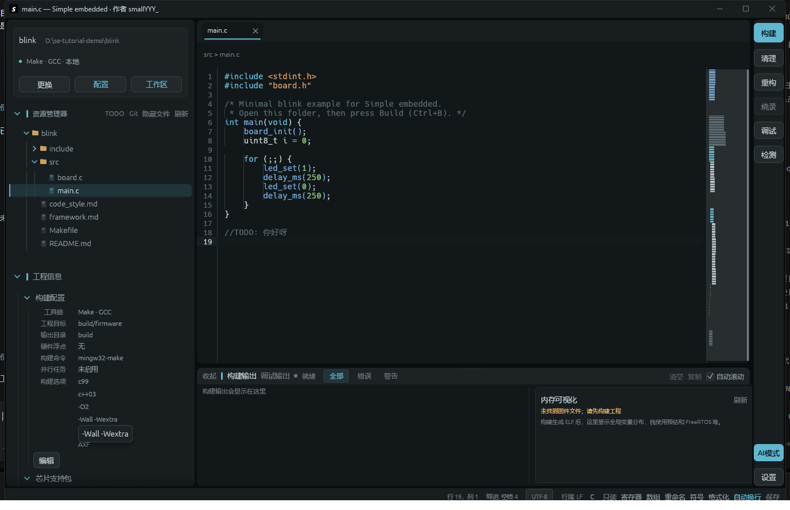

上图是打开工程后的默认布局，可以分成九个区域：

| 区域 | 位置 | 作用 |
|---|---|---|
| 构建卡片 | 左上 | 工程名、路径、芯片、工具链、构建位置，以及更换 / 配置 / 工作区 |
| 资源管理器 | 左中 | 文件树、TODO、Git、隐藏文件、刷新 |
| 工程信息 | 左下 | 构建配置、芯片支持包、烧录配置、C/C++ 属性、资源报告 |
| 标签页 | 中上 | 多文件编辑，支持拆分和右键菜单 |
| 编辑器 | 中间 | 行号、语法高亮、小地图、折叠、补全、悬停等 |
| 输出面板 | 中下 | 构建输出 / 调试输出，错误过滤，点击跳转 |
| 内存可视化 | 右下 | ELF 全局变量、栈、FreeRTOS 堆的占用 |
| 右侧操作栏 | 最右 | 构建、清理、重构、烧录、调试、检测、设置 |
| 状态栏 | 最底 | 行列、缩进、编码、行尾、语言、格式化和保存 |

### 1.1 第一次构建

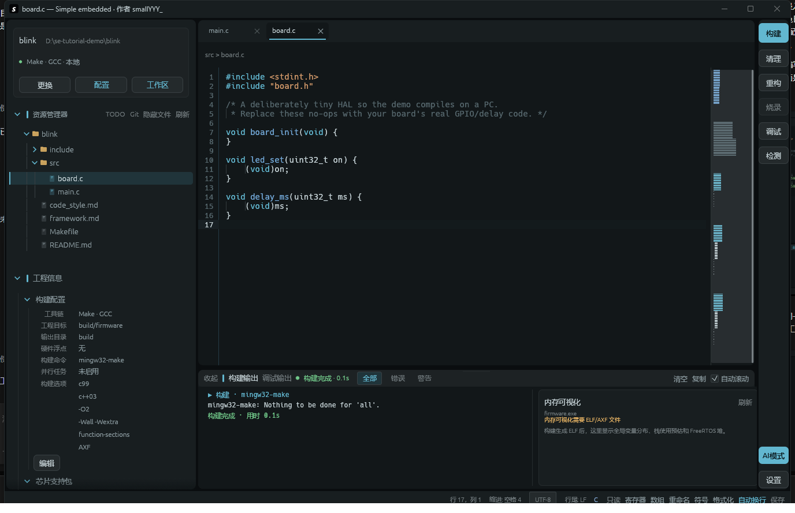

操作步骤：

1. 点右侧操作栏 **构建**（或按 `Ctrl+B`）。
2. 构建前软件会自动保存所有未保存的标签页。
3. 底部 **构建输出** 会实时显示命令、编译器输出和结果。
4. 构建成功后标题显示 **构建完成** 和用时；失败时显示 **构建失败** 和退出码。
5. 日志中的 `文件:行:列` 可以点击，直接跳到编辑器对应位置。
6. 输出面板右上角可以 **清空**、**复制**、开关 **自动滚动**，也可以按 **全部 / 错误 / 警告** 过滤。
7. MicroPython 工程下，构建输出页会变成 **MicroPython 输出**，右侧按钮变为运行 / 上传 / 固件 / 复位。

> 构建失败时，如果日志里出现 `undefined reference to ...`，软件会额外提示检查对应 `.c` 是否加入 `C_SOURCES`、函数是否实现、是否误加了 `static`。

---

## 2. 原始模式各板块

### 2.1 左侧构建卡片

构建卡片显示：

- **工程名**（粗体）和工程完整路径。
- **工具链** 和 **构建位置**，例如 `Make · GCC · 本地`。
- 从 Makefile / `.uvprojx` 检测到的芯片型号。
- 三个按钮：**更换 / 配置 / 工作区**。

按钮说明：

| 按钮 | 用途 |
|---|---|
| 更换 | 重新选择工程文件夹 |
| 配置 | 打开工程配置（构建 / 编辑器 / 调试 / 其他），也可以按 `Ctrl+,` |
| 工作区 | 生成并关联 `<工程名>.se-workspace`、打开工作区文件、打开工程配置 `settings.json` |

> 没有打开工程时，三个按钮是 **导入 / 配置 / 工作区**，中间编辑器只显示“请在左上角选择工程并开始”。

### 2.2 资源管理器

资源管理器以工程文件夹作为第一行，文件夹和文件按名称排序：

- 目录优先，名称不区分大小写。
- 每个目录可以展开 / 收起，展开状态有缓动动画。
- 目录层级用竖线显示缩进参考线。
- 文件图标区分普通文件、头文件、源文件和图片等。
- 顶部提供 **TODO**、**Git**、**隐藏文件**、**刷新**。
- 文件右侧会显示 Git 状态徽标：`M` 修改、`U` 未跟踪、`A` 新增、`D` 删除、`R` 重命名。
- 默认隐藏 `.` 开头的文件 / 目录，可以点 **隐藏文件** 切换。

右键菜单：

- 文件：在侧边打开、剪切、复制、复制路径、复制相对路径、重命名、删除、查看、十六进制、在资源管理器中显示。
- 文件夹：新建文件、新建文件夹、粘贴、剪切、复制、重命名、删除。
- 项目根目录：新建文件 / 文件夹、粘贴、在资源管理器中显示、复制路径、用 VS Code 打开。

文件操作规则：

- 复制 / 剪切使用软件内部的文件剪贴板，不读写系统剪贴板中的文件。
- 粘贴重名时自动生成 `名称 - 副本.ext`、`名称 - 副本 (2).ext`。
- 剪切遇到同名目标会提示；跨盘移动失败时会退化为复制后删除。
- 重命名和删除都有确认弹窗；删除前如果存在未保存的标签页会拒绝执行。
- 删除 `.c` / `.cpp` 文件后，会自动从 Makefile 的 `C_SOURCES` 移除对应条目（有未保存的 Makefile 时跳过并提示）。
- 当前没有文件系统 watcher；外部修改文件后，点 **刷新** 重新读取。

### 2.3 编辑器

#### 标签页与分屏

- 每个打开的文件一个标签页，未保存时标签页显示脏标记。
- 标签页右键菜单提供：关闭其他、关闭右侧、关闭已保存、全部关闭、保存、另存为、复制完整路径、复制相对路径、在资源管理器中显示、在资源管理器视图中显示、向右拆分、向上拆分、取消拆分。
- 拆分后两个窗格都可以编辑，点击窗格切换焦点。
- 快捷键：`Ctrl+F4` 关闭当前，`Ctrl+\` 向右拆分，`Ctrl+K Ctrl+\` 向上拆分，`Ctrl+K W` 全部关闭，`Ctrl+K S` 保存全部。

#### 编辑区

- 左侧行号、当前行高亮、断点红点、书签竖条、Git 修改行黄条。
- 顶部面包屑只显示从工程根目录开始的路径，例如 `src > board.c`。
- 右侧小地图按 revision 缓存，可点击或拖动跳转，并显示当前视口位置。
- 缩进参考线按 `indent_width` 绘制，当前缩进级别会高亮。
- 自动换行、相对行号、空白字符、80/120 列标尺、代码字号都可以在配置或状态栏调整。
- 编码支持 UTF-8（含 BOM）和 GBK；状态栏可切换。
- 行尾支持 CRLF / LF，保存时按原文件写回。
- 二进制文件自动进入只读十六进制视图，不按文本打开。

#### 查找与替换

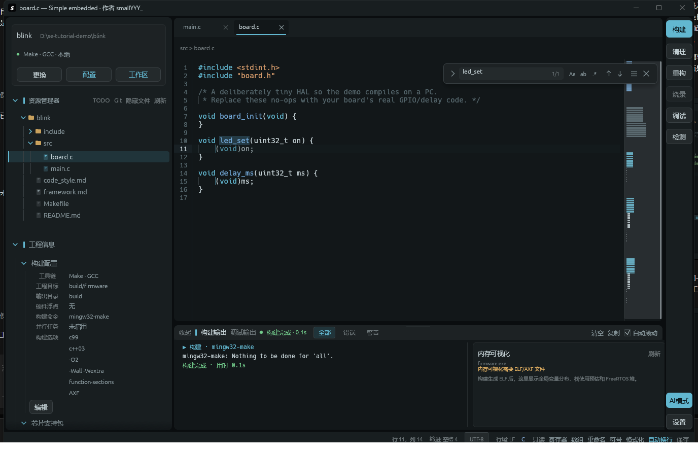

- `Ctrl+F` 打开当前文件查找，`Ctrl+H` 打开替换。
- 查找浮层在编辑器右上角，支持：
  - `Aa` 大小写敏感
  - `ab` 全字匹配
  - `*` 正则表达式
  - 上一个 / 下一个
  - `≡` 打开全工程搜索
- 替换时 `AB` 表示保留大小写。
- `Ctrl+G` 打开跳行浮层，输入行号回车跳转。
- `Ctrl+Shift+F` 或查找浮层的 `≡` 打开全工程搜索；结果窗口按文件分组，点击结果跳转。
- `F3` / `Shift+F3` 查找下一个 / 上一个。

#### 符号、TODO、引用和寄存器

| 功能 | 快捷键 / 入口 | 说明 |
|---|---|---|
| 工程符号 | `Ctrl+Shift+O` | C/C++ 函数、结构体、宏、汇编标签 |
| TODO | `Ctrl+Shift+T` 或资源管理器 **TODO** | `TODO` / `FIXME` / `HACK` / `NOTE` |
| Git 状态 | `Ctrl+Shift+G` | 分支、变更列表，只读，不自动提交 |
| 寄存器 | `Ctrl+Shift+R` | SVD / `.pack` / 头文件宏 |
| 跳转定义 | `F12` | 优先 clangd，失败回退符号索引 |
| 查找引用 | `Shift+F12` | 优先 clangd，失败回退工程搜索 |
| 重命名 | `Ctrl+Shift+F2` 或状态栏 **重命名** | clangd 可用时按语义重命名 |
| 补全 | `Ctrl+Space` | 输入至少 2 个标识符字符自动弹出 |
| 悬停提示 | 鼠标悬停标识符 | 声明签名、注释、返回类型、调用 / 引用关系 |
| 括号跳转 | `Ctrl+]` | 跳到配对括号 |
| 行注释 | `Ctrl+Enter` 或 `Ctrl+/` | 单行注释，多行选区整体切换 |
| 折叠 | `Ctrl+Shift+[` / `Ctrl+Shift+]` | 折叠当前块 / 展开全部 |
| 多光标 | `Alt+Click`、`Ctrl+Alt+Up/Down`、`Ctrl+D` | `Esc` 清除 |
| 列选择 | `Ctrl+Alt+鼠标左键拖动` | 矩形选择、复制、删除、替换 |
| 格式化 | 状态栏 **格式化** | clang-format，失败只提示 |
| 自动换行 | 状态栏 **自动换行** | 长行折行显示 |
| 保存 | `Ctrl+S` | 保存当前文件 |
| 另存为 | `Ctrl+Shift+S` | 保存到新路径 |
| 撤销 / 重做 | `Ctrl+Z` / `Ctrl+Shift+Z` 或 `Ctrl+Y` | 跨文件快照栈 |
| 书签 | `Ctrl+F2`、`F2`、`Shift+F2` | 切换、下一个、上一个 |
| 十六进制 | `Ctrl+Shift+H` | 当前文件只读十六进制 |
| 数组生成 | `Ctrl+Shift+A` | 选中文本或当前文件生成 C 数组 |

> 补全、跳转、引用和悬停在没有 clangd 时使用轻量索引，不是完整 C/C++ 语义分析；复杂宏、模板、继承和函数指针可能漏检。启用 clangd 后语义功能以 clangd 为准。

### 2.4 输出面板与内存可视化

输出面板位于编辑器下方，顶部有 10px 拖动手柄，收起时也可以向上拉出：

- **构建输出**：构建 / 清理 / 重构 / 烧录产生的日志。
- **调试输出**：gdb 会话日志，底部可以输入 gdb 命令。
- **MicroPython 输出**：MicroPython 模式下的运行 / 上传 / 固件 / 复位日志。
- **全部 / 错误 / 警告**：过滤日志。
- **清空 / 复制 / 自动滚动**：管理日志。
- 日志带 ANSI 颜色，错误和警告行优先级更高。
- 点击日志中的 `file:line:col` 跳到源码位置。
- 构建结果标题显示 `Flash 已用 / 总量 · RAM 已用 / 总量`（来自 ELF / 链接脚本 / PDSC）。

右侧 **内存可视化**：

- 解析 ELF32/64 符号表，列出写入型 `.data` / `.bss` 全局变量（最多 200 个，面板展示前 14 个）。
- 显示 `_estack` / `_Min_Stack_Size` 栈区、`ucHeap` / `.heap` FreeRTOS 堆区。
- 调试暂停且寄存器可用时，用 SP 估算当前栈使用；否则显示静态预留。
- 点 **刷新** 强制重新读取 ELF。

### 2.5 工程信息

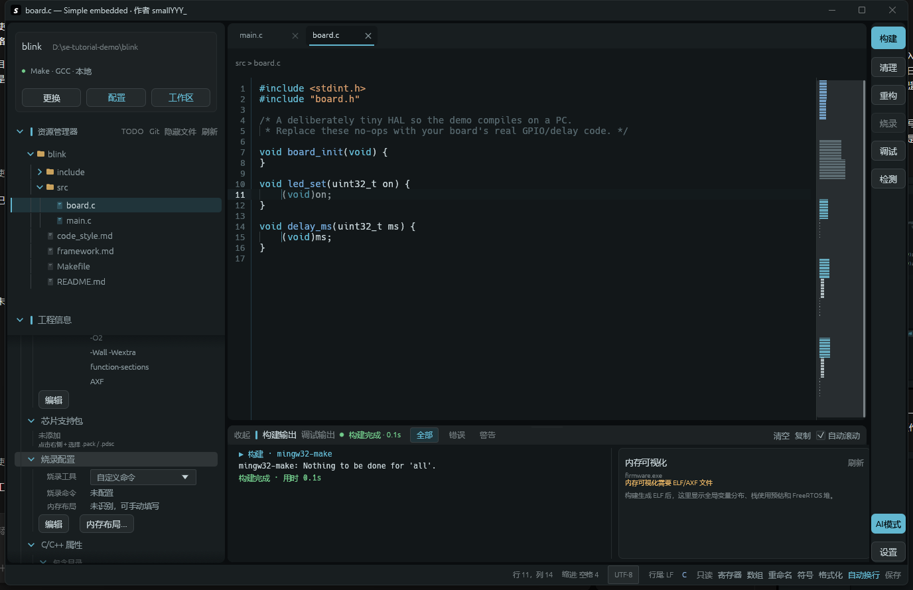

工程信息在资源管理器下方，包含构建配置、芯片支持包、烧录配置、C/C++ 属性，以及底部的资源报告：

#### 构建配置

显示工具链、工程目标、输出目录、硬件浮点、构建命令、并行任务数、构建选项等。工具链在这里只读，修改入口是 **配置 → 构建**。

#### 芯片支持包

- 点绿色 `+` 选择 Keil/CMSIS `.pack` / `.pdsc`。
- 文件会复制到工程根目录（同名不覆盖）。
- 显示包名、厂商、版本、设备列表和 SVD 数量。
- 寄存器浏览器可以直接读取包内 SVD。
- 不会导入 Keil 设备树、启动文件、链接脚本或烧录算法。

#### 烧录配置

- 烧录工具：自定义命令 / OpenOCD / pyOCD。
- OpenOCD：工具路径、程序文件、芯片配置、接口配置。
- 接口配置支持 ST-Link、CMSIS-DAP / DAPLink、J-Link、XDS110、ULINK 等预设，也可以手填。
- **自动检测** 通过 USB VID 识别已连接的探针。
- pyOCD：工具路径、目标芯片、可选 Pack、程序文件。
- 程序文件支持 `${ExecutableName}`、`${ProjectName}`、`${workspaceFolder}`、`${workspaceRoot}`。
- **内存布局...** 打开 Cortex-Debug 风格的两列网格，保存 IRAM / IROM 区域，但不会改写链接脚本。
- **编辑** 打开独立烧录配置弹窗，含命令预览。

#### C/C++ 属性

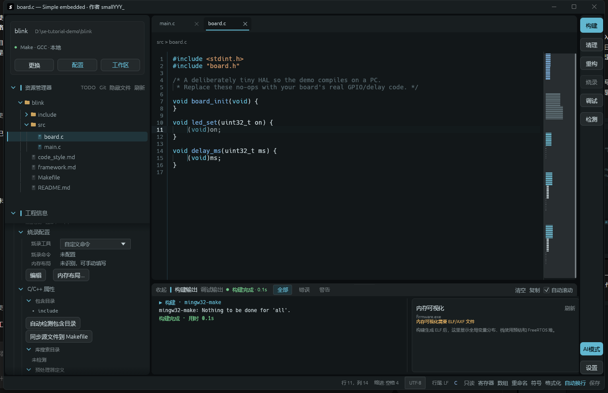

- 包含目录、库搜索目录、预处理器定义。
- 每个列表右侧绿色 `+` 添加。
- **自动检测包含目录**：递归扫描工程内头文件，把父目录追加到包含目录。
- **同步源文件到 Makefile**：扫描 `.c` / `.cc` / `.cpp` / `.cxx`，把未加入的源文件追加到 `C_SOURCES`。
- 只对有效构建系统为 Make 的工程同步到 Makefile，修改前自动备份。
- Keil AC5/AC6 只写入工程配置，不修改 `.uvprojx`。

#### 资源报告

- 点 **生成资源报告**，后台扫描工程并写入 `<工程名>.resources.json`。
- 包含硬件（芯片、内存、SVD、`.ioc` 引脚 / 组件）、软件（源码 / 头文件 / 库 / 符号 / 调用图）和系统信息。
- 报告是静态分析，不替代原理图、BOM 或链接映射文件。

### 2.6 右侧操作栏

从上到下：

| 按钮 | 作用 |
|---|---|
| 构建 | Build 命令 |
| 清理 | Clean 命令 |
| 重构 | Rebuild 命令 |
| 烧录 | 自定义 / OpenOCD / pyOCD |
| 调试 | 启动 / 继续调试 |
| 检测 | 静态内存检查；有调试会话时打开动态监测 |
| 设置 | 应用设置（编辑器主题） |

MicroPython 模式下按钮变为 **运行 / 上传 / 固件 / 复位**：

- **运行**：把当前 `.py` 上传为 `main.py` 并发送 Ctrl-D 软复位。
- **上传**：写回开发板；从芯片下载的文件会优先写回原芯片路径。
- **固件**：调用 esptool 烧录 `.bin`，弹出确认窗口。
- **复位**：只发送 Ctrl-D。

### 2.7 调试

- `F5` 启动 / 继续；目标运行中浮层主按钮显示暂停。
- `F9` 或点击行号左侧空白切换断点。
- `F10` 下一步，`F11` 单步进入，`Shift+F11` 跳出，`Shift+F5` 停止。
- 调试控制浮层在编辑器右上角，最左侧准心按钮回到当前执行行。
- 调试日志在输出面板的 **调试输出** 页。
- 调试侧栏有 **变量 / 寄存器 / 外设** 三个页签：
  - 变量：Live Watch。
  - 寄存器：只读寄存器表。
  - 外设：SVD 外设 → 寄存器 → 位域，支持读取和写入（目标必须暂停）。
- **动态监测**：用 `watch` / `rwatch` / `awatch` 设置硬件 watchpoint，命中后自动暂停并记录时间、旧值 → 新值、GDB 停止位置和调用栈。
- ARM ELF/AXF 会复用 OpenOCD / pyOCD 配置启动 GDB server，再由 `arm-none-eabi-gdb` 连接。

### 2.8 配置窗口

按 `Ctrl+,` 或点构建卡片的 **配置** 打开，标题为“配置”，包含四个页签。

#### 构建

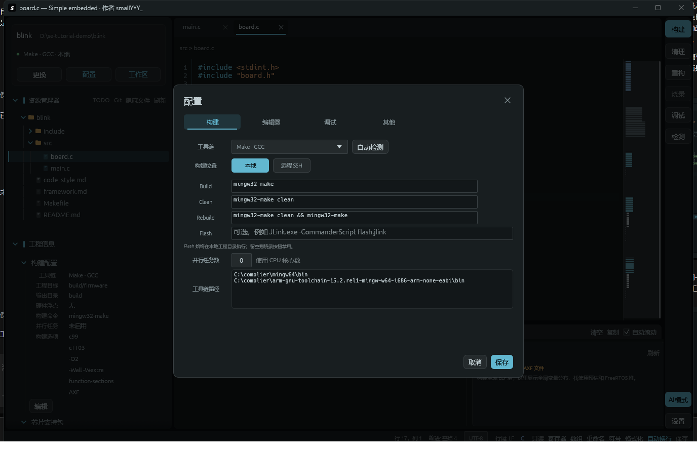

- 工具链下拉 + **自动检测**。
- 构建位置：本地 / 远程 SSH。
- Build / Clean / Rebuild / Flash 命令。
- 并行任务数（0 = 不启用，可一键填入 CPU 核心数）。
- 工具链路径（对应 `extra_paths`，多行输入）。
- SSH 主机、端口、远端目录（选择远程 SSH 时显示）。
- MicroPython 工具链下，这里切换为串口连接面板：端口、波特率、自动检测。

#### 编辑器

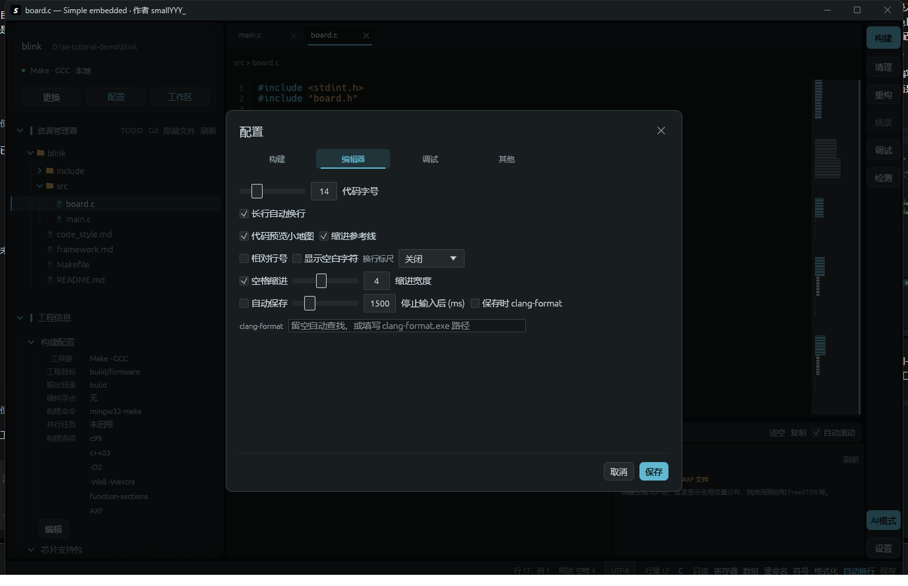

- 代码字号。
- 长行自动换行。
- 代码预览小地图。
- 缩进参考线。
- 相对行号、显示空白字符、换行标尺。
- 空格缩进、缩进宽度。
- 自动保存及停止输入后的延迟。
- 保存时 clang-format。
- clang-format 路径（留空自动查找）。

#### 调试

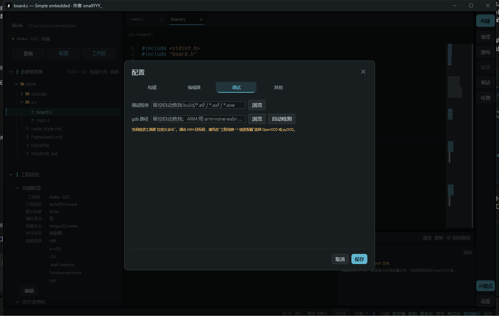

- 调试程序路径，留空自动在 `build/`、`Debug/`、`Release/` 等目录查找。
- gdb 路径，ARM 工程应使用 `arm-none-eabi-gdb`。
- 浏览和自动检测按钮。
- 底部提示：如果烧录工具是自定义命令，调试 ARM 目标前要先在工程信息中把烧录工具改成 OpenOCD 或 pyOCD。

#### 其他

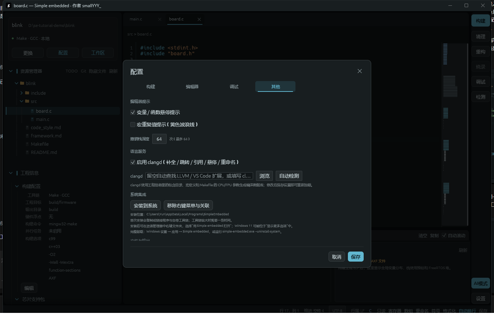

- 变量 / 函数悬停提示。
- 宏重复值提示（黄色波浪线，默认关闭）。
- 撤销栈深度（默认 64，最大 64）。
- 语言服务：启用 clangd、clangd 路径、浏览、自动检测。
- 系统集成：安装到系统 / 移除右键菜单与关联。

### 2.9 应用设置与主题

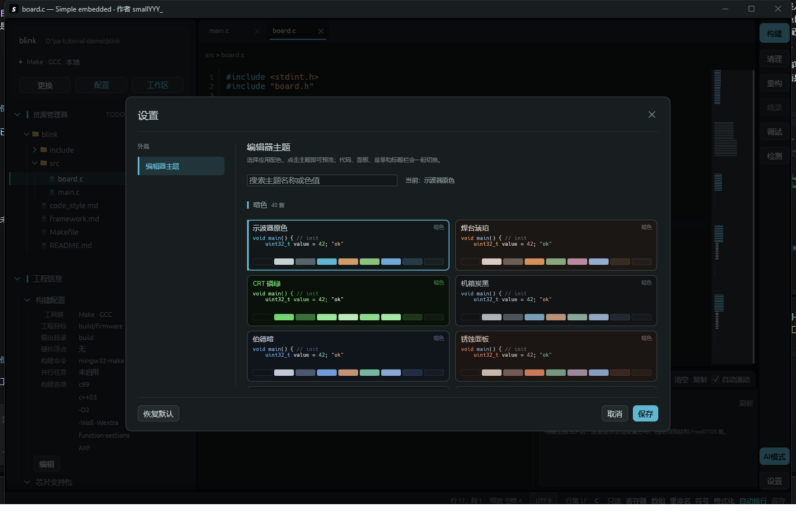

点右侧操作栏最底部的 **设置** 打开，第一个菜单是 **编辑器主题**：

- 内置 40 套暗色 + 10 套亮色，共 50 套主题。
- 支持按名称或色值搜索。
- 主题卡片展示名称、明暗标签、语法示例和 9 色色板。
- 点击卡片即时预览整个应用（编辑器、侧栏、面板、菜单、状态栏、Windows 标题栏）。
- 点 **保存** 写入全局设置；取消、关闭或 `Esc` 恢复原主题。
- 窗口左下角有 **恢复默认**。

主题之外，系统集成、clangd、撤销深度等在 **配置 → 其他**。

### 2.10 状态栏

最底部状态栏贯穿窗口宽度，右侧集中显示：

- 当前行、列。
- 缩进方式。
- 编码（UTF-8 / GBK）。
- 行尾（CRLF / LF）。
- 语言。
- 只读。
- 寄存器、数组、重命名、符号、格式化、自动换行、保存等操作入口。

### 2.11 常用快捷键

| 快捷键 | 功能 |
|---|---|
| `Ctrl+O` | 打开工程文件夹 |
| `Ctrl+S` | 保存 |
| `Ctrl+Shift+S` | 另存为 |
| `Ctrl+K S` | 保存全部 |
| `Ctrl+B` | 构建 |
| `Ctrl+Shift+B` | 重构 |
| `Ctrl+,` | 打开配置（AI 模式下打开 AI 设置） |
| `Ctrl+Alt+A` | 进入 / 退出 AI 模式 |
| `Ctrl+F` / `Ctrl+H` | 查找 / 替换 |
| `Ctrl+Shift+F` | 全工程搜索 |
| `Ctrl+G` | 跳行 |
| `Ctrl+Shift+O` | 工程符号 |
| `Ctrl+Shift+T` | TODO |
| `Ctrl+Shift+R` | 寄存器 |
| `Ctrl+Shift+G` | Git 状态 |
| `Ctrl+Shift+H` | 十六进制查看 |
| `Ctrl+Shift+A` | 数组生成 |
| `F12` / `Shift+F12` | 跳转定义 / 查找引用 |
| `Ctrl+Shift+F2` | 重命名 |
| `Ctrl+]` | 跳到配对括号 |
| `Ctrl+Shift+[` / `Ctrl+Shift+]` | 折叠当前块 / 展开全部 |
| `F2` / `Shift+F2` | 下一个 / 上一个书签 |
| `Ctrl+F2` | 切换书签 |
| `Ctrl+Z` / `Ctrl+Shift+Z` | 撤销 / 重做 |
| `Ctrl+W` / `Ctrl+F4` | 关闭当前标签页 |
| `Ctrl+\` | 向右拆分 |
| `Ctrl+=` / `Ctrl+-` | 放大 / 缩小字号 |
| `F5` / `Shift+F5` | 启动调试 / 停止 |
| `F9` / `F10` / `F11` / `Shift+F11` | 断点 / 下一步 / 单步进入 / 跳出 |

---

## 3. AI 模式

### 3.1 进入与退出

- 点右侧操作栏底部的 **AI模式**，或按 `Ctrl+Alt+A`。
- 进入时整个窗口切换为 AI 四栏布局，并在约 1 秒内依次淡入；UI 缩放临时变为 1.2，退出后恢复。
- 点右侧工作台底部 **原始模式**，或再次按 `Ctrl+Alt+A`，回到原始模式。
- **退出 AI 模式不会中止正在生成的回复**：后台继续接收，重新进入后还能看到正文、思考过程、待回答的问题和待应用的修改。
- AI 模式不显示状态栏、左侧资源管理器和底部输出面板；需要看代码时按 `Ctrl+Alt+A` 回原始模式。

### 3.2 四栏总览

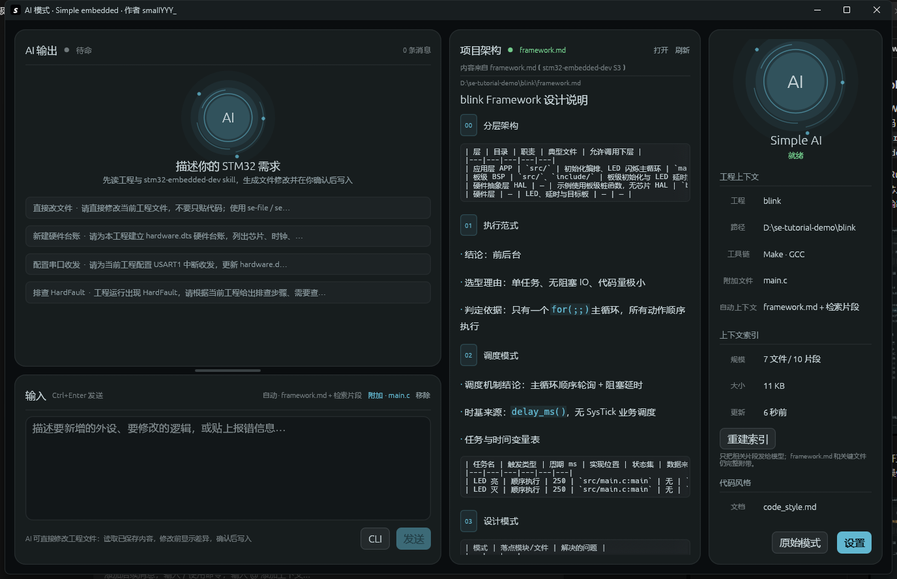

| 区域 | 位置 | 作用 |
|---|---|---|
| AI 输出 | 左上 | 对话、思考过程、Markdown、代码块、操作卡片 |
| 输入 | 左下 | 描述需求、附加文件、CLI 入口、发送 |
| 项目架构 | 中间 | 只读 `framework.md` 的分层、执行范式、调度、设计模式、调用图和甘特图 |
| AI 工作台 | 右侧 | AI 图标、工程上下文、上下文索引、代码风格、串口 CLI、Skill、原始模式、设置 |

输出面板右上角会显示 **待命 / 生成中 / 待确认 / 已完成** 等状态。

### 3.3 AI 输出与操作卡片

AI 回复支持：

- **思考过程** 卡片：默认展开，可收起、复制，最多 300KB。
- 正文流式显示；完成后切换为 Markdown。
- 普通代码块：语言标签 + 复制按钮 + 横向滚动。
- 如果模型只输出了思考过程、没有正文，IDE 会自动追加“停止思考，直接输出正文/承诺的文件”提示并重试最多 2 次；仍为空才显示错误，不会直接以“只返回了思考过程”结束。
- 文件修改、文件删除、需要确认、构建验证、串口 Debug、问题记录、技能进化分别显示为独立卡片。

#### 文件修改卡片

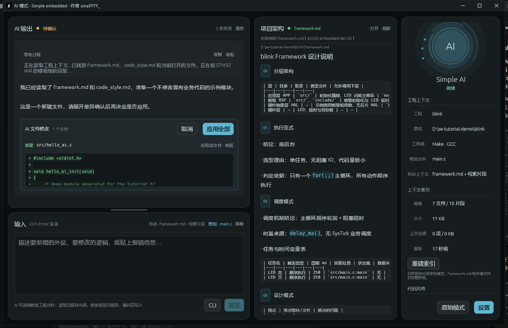

- 卡片列出文件、新建 / 覆盖 / 替换类型。
- 点 **差异** 展开行级 diff：绿色 `+` 新增，红色 `-` 删除。
- 每个文件右侧 **应用此文件**，只写入当前文件。
- **应用全部** 只应用所有尚未应用且没有错误的文件。
- **取消** 不写入；已经部分应用后显示 **取消剩余**。
- 应用前会校验路径、生成目录、二进制扩展名、base hash、未保存标签页。
- 写入前把原文件备份到 `%APPDATA%\SimpleEmbedded\backups\<工程名>-<hash>\ai-<时间戳>\`。
- 如果某个 `SEARCH` 片段匹配不到，会显示原因和 **分析原因**；IDE 会把原片段、当前文件和哈希差异发给 AI，让它只重新生成这一处。
- 卡片顶部 **分析失败原因** 一次最多分析 2 个失败文件。

#### 文件检索卡片

当自动上下文不够时，AI 可以主动请求读取工程文件，而不是直接说“我看不到”：

~~~~text
````se-list path=Core/Src depth=2
````
````se-read path=Core/Src/main.c lines=1-200
````
~~~~

- IDE 在工程根目录内读取真实目录/文件，把结果加入下一轮上下文并自动继续，最多 6 轮。
- 聊天里显示 **AI 文件检索** 卡片，列出请求和结果摘要，读取内容默认折叠。
- `se-list` 支持 `depth=1-3`；`se-read` 支持 `lines=起-止`，单文件最多 24KB，单轮最多 48KB、12 个请求。
- 禁止工程外路径、`..`、生成/配置目录、`.opencode`、符号链接和二进制文件；唯一例外是 `.opencode/skills/stm32-embedded-dev/` 下的 `.md` 参考文件可只读读取（用于补读未加载的 skill 文件）。
- 只写“读取目标 / 本轮读取 / 下一轮读取”的计划或表格不算请求，必须实际输出四反引号 `se-read` / `se-list` 块；只写计划时 IDE 会自动要求重写，连续 2 次仍不输出可执行块就停止自动检索并提示你手动打开文件。
- 同一回复还有待确认卡片时，IDE 会保留读取结果，处理完后下一条消息会带上。

#### 需要确认卡片

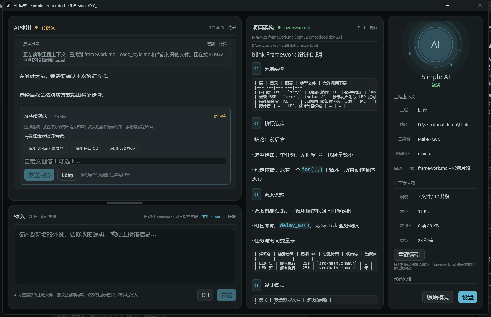

- 每个问题可以有 2–8 个选项。
- `se-ask multiple` 的问题可以多选。
- 也可以完全自由回答，在 **自定义回答** 输入框里填写。
- 所有问题都有选择或自定义文本后，**发送回答** 才可用。
- 回答会拼成一条“回答你的确认问题：…”消息发出，不占用底部输入框，也不会丢失草稿。
- 一次最多 6 个问题；已提交或取消的卡片保留问题并显示状态。
- 如果模型没有输出 `se-ask`、但在正文写了明确的授权/决策问句（例如“请允许我…”“是否继续 / 替换 / 重构”），IDE 会自动把它转成问答卡片，并提供“允许 / 不允许”“继续 / 暂停”“替换 / 保留”等默认选项。
- 只读的 `se-list` / `se-read` 不需要授权，AI 应直接读取；需要确认的只应是写文件、删除、重构、烧录等有副作用的动作。

#### 文件删除卡片

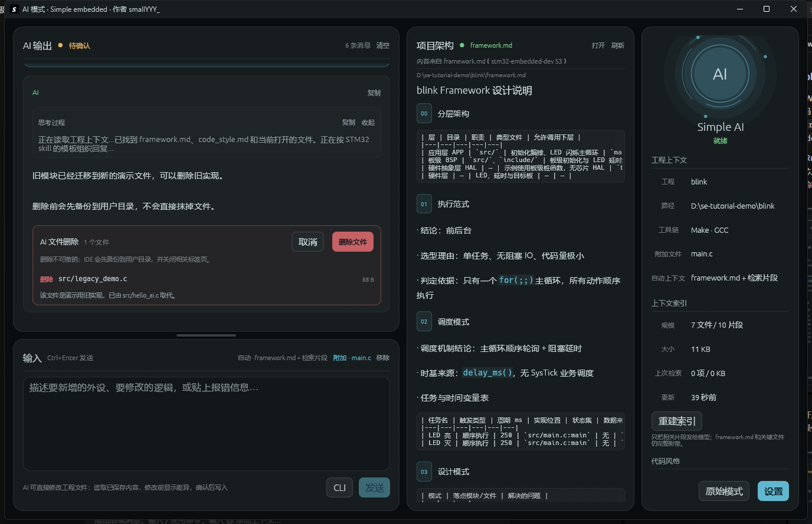

- AI 用 `se-delete` 提出，不会用空文件或“请手动删除”注释代替。
- 卡片显示路径、大小和删除原因。
- 只有点 **删除文件** 才执行；点 **取消** 不删除。
- 删除前备份到 `%APPDATA%\SimpleEmbedded\backups\<工程名>-<hash>\ai-delete-<时间戳>\`，并写 manifest。
- 只支持工程内普通文件，一次最多 10 个；不支持目录、重命名、移动。
- 删除后会关闭相关标签页、清理断点 / 分屏 / 调试位置、同步 Makefile `C_SOURCES`。

#### 构建验证卡片

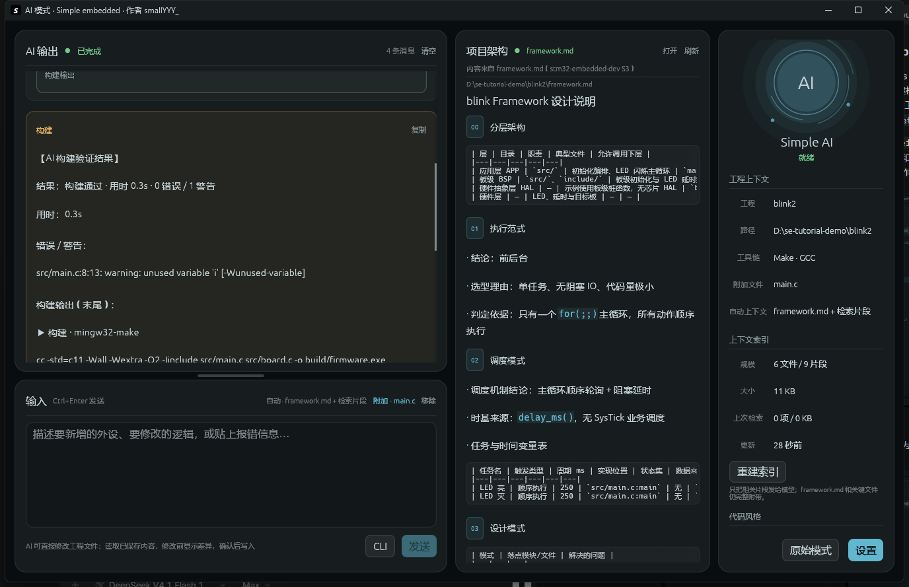

- AI 用 `se-build` 请求 IDE 执行当前工程的 **真实 Build**。
- IDE 捕获构建输出，优先保留错误 / 警告，压缩后作为报告自动发回 AI。
- 失败时 AI 继续修复并再次请求构建，最多 5 轮。
- 只有 IDE 回传 0 error 才允许结束；达到轮次上限后只保留报告，等待你手动继续。
- 同一回复还有待应用的修改 / 删除 / 确认问题时，构建会等待这些卡片处理完。
- 退出 AI 模式只停止自动回传，构建继续在后台运行。

#### 串口 Debug 卡片

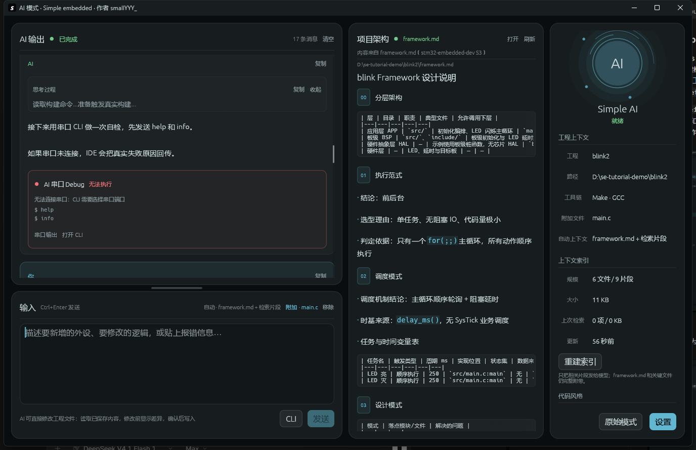

- AI 用 `se-cli` 提出命令，每行一条，最多 32 条。
- IDE 自动连接项目配置的串口（未选端口时尝试自动检测），按行尾逐条发送，每条等待 `cli.timeout_ms` 后截取输出。
- 全部结束后把真实输出作为报告自动发回 AI。
- 失败 / 无响应会显示原因，不会伪造 `OK`。
- 最多自动回传 5 轮。
- 卡片底部 **打开 CLI** 可以打开完整串口窗口。

#### 问题记录卡片

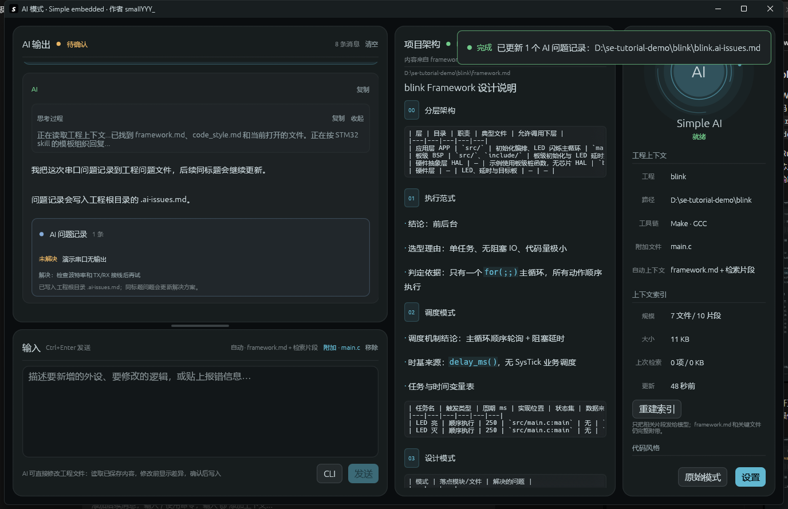

- AI 用 `se-issue` 记录标题、状态、现象、原因、解决方案、相关文件。
- 立即写入工程根目录 `<工程名>.ai-issues.md`。
- 同标题（不区分大小写）更新已有记录；`status=resolved` 标记已解决。
- 该文件由 IDE 维护，AI 不能用 `se-file` / `se-delete` 修改或删除。

#### 技能进化卡片

- AI 遇到你的长期偏好或纠正时，用 `se-evolve` 提议一条“场景 / 做法 / 原因”规则。
- 点 **保存规则** 后写入用户级 `%APPDATA%\SimpleEmbedded\ai\evolution\stm32-embedded-dev.md`。
- 后续请求会同时读取全局规则和项目级 `evolution-user.md`，优先于默认 Skill 写法，但不覆盖安全、硬件事实和当前指令。

### 3.4 输入面板

- 输入框在左下，`Ctrl+Enter` 发送，或点 **发送**。
- 进入 AI 模式时默认把当前文件作为 **附加文件**，显示在输入框右上角，可以点 **移除**。
- 输入框内容较长时可以用鼠标滚轮 / 触控板滚动；也可以拖动 AI 输出和输入之间的水平分隔条，把输入框拉大。
- 输入面板右侧有 **CLI** 按钮，打开串口 CLI 窗口。
- 发送前自动保存所有未保存标签页；保存失败会中止发送。
- 发送普通用户消息会取消当前构建验证 / 串口验证，并重置自动轮次。

### 3.5 项目架构面板

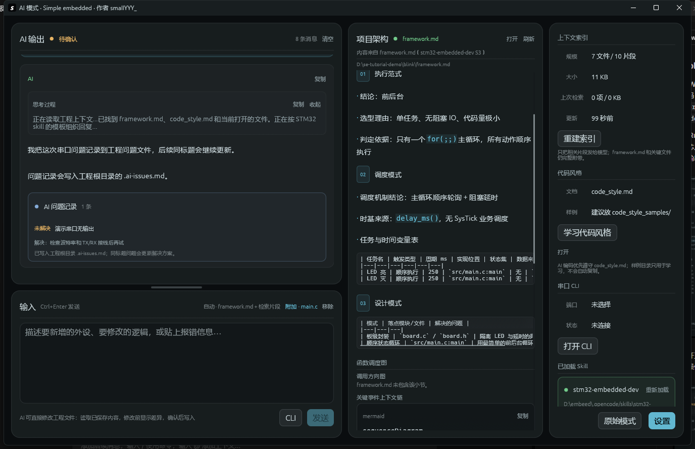

中间面板只读取 Skill 生成的 `framework.md`：

- 优先在工程根目录、`docs/`、`doc/` 下查找，找不到再限深递归。
- 没有文档时显示 **等待 framework.md** 和 **让 AI 生成**。
- 文档存在但缺少固定小节时显示 **文档不完整**，并提供“让 AI 补全”。
- 有文档时按以下结构展示：
  - **00 分层架构**：`1.1 层级表`
  - **01 执行范式**：`2.1 执行范式`
  - **02 调度模式**：`2.2 调度模式`
  - **03 设计模式**：`2.3 设计模式`
  - **函数调度图**：`1.3 调用方向图`、`3.4 关键事件上下文链`
  - **调度入口**：`3.1 启动调用链`
  - **中断与任务**：`3.3 中断来源与抢占关系`
  - **04 调度甘特图**：解析 `3.2` 中的 Mermaid `gantt`
- 顶部显示文档路径，**打开** 在编辑器中打开全文，**刷新** 立即重读。
- 每 800ms 检查文件修改时间，AI 生成 / 保存 / 应用修改后自动刷新。
- Mermaid 图以源码块 + 复制按钮显示；只有 3.2 的简单 `gantt` 会画成示意图。
- 甘特图是文档中的规划视图，不是实测 trace。

### 3.6 AI 工作台

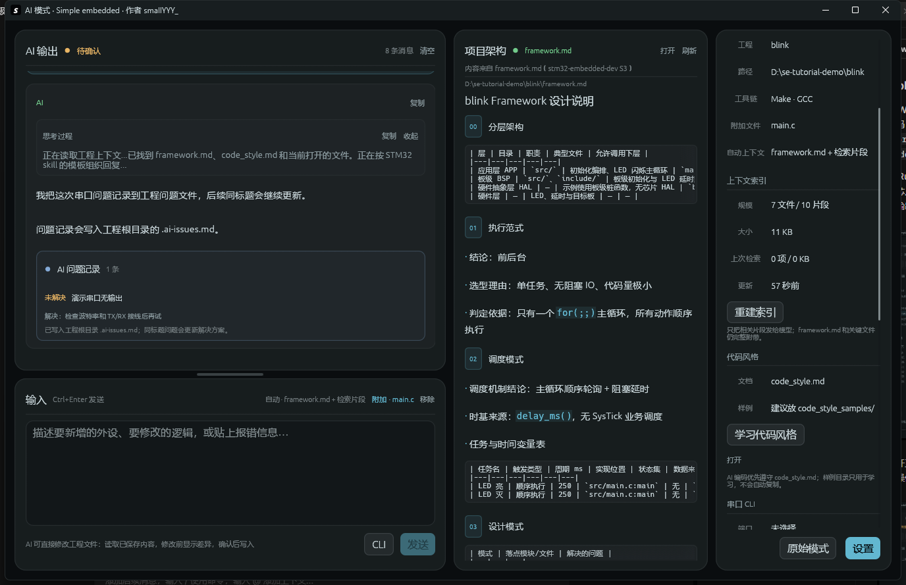

从上到下：

#### AI 图标

- 显示 Simple AI 状态。
- **双击** AI 图标：在工程根目录创建 / 打开 `evolution-user.md`，退出 AI 模式并在编辑器中打开，方便编辑项目级用户规则。

#### 工程上下文

- 工程名、根目录、工具链。
- 当前附加文件。
- 自动上下文：`framework.md` + 检索片段。

#### 上下文索引

- 显示已索引文件数 / 片段数、大小、上次检索、更新时间。
- **重建索引** 立即后台重建。
- 打开工程后后台扫描，最多 1200 文件 / 6000 个 48 行片段。
- 跳过 `build`、`Drivers`、`tools`、`.opencode`、`code_style_samples` 等目录。
- 保存、应用 AI 修改、删除文件后标记过期，下次发送重建。
- 索引是词法检索（BM25 风格 + 路径加权），不理解同义词、类型关系或宏展开；检索不到时回退到完整源文件。

#### 代码风格

- 显示 `code_style.md` 是否已生成、样例目录状态。
- **学习代码风格**：发送 T7 提示，扫描 `code_style_samples/`、根目录上传的 `.c/.h` 和现有 APP / MID / BSP / Core 源码，归纳文件头、命名、缩进、注释、类型 / 宏、错误码、日志、模块封装、中断调度和优化偏好，用 `se-file` 生成 / 更新 `code_style.md`。
- **打开**：在编辑器中打开 `code_style.md`。
- 只要工程根目录存在 `code_style.md`，后续请求都会以最高优先级附带；与默认规则冲突时以用户风格为准，但不覆盖安全、硬件事实和当前指令。
- 样例目录只用于学习，不会自动复制进业务目录。

#### 串口 CLI

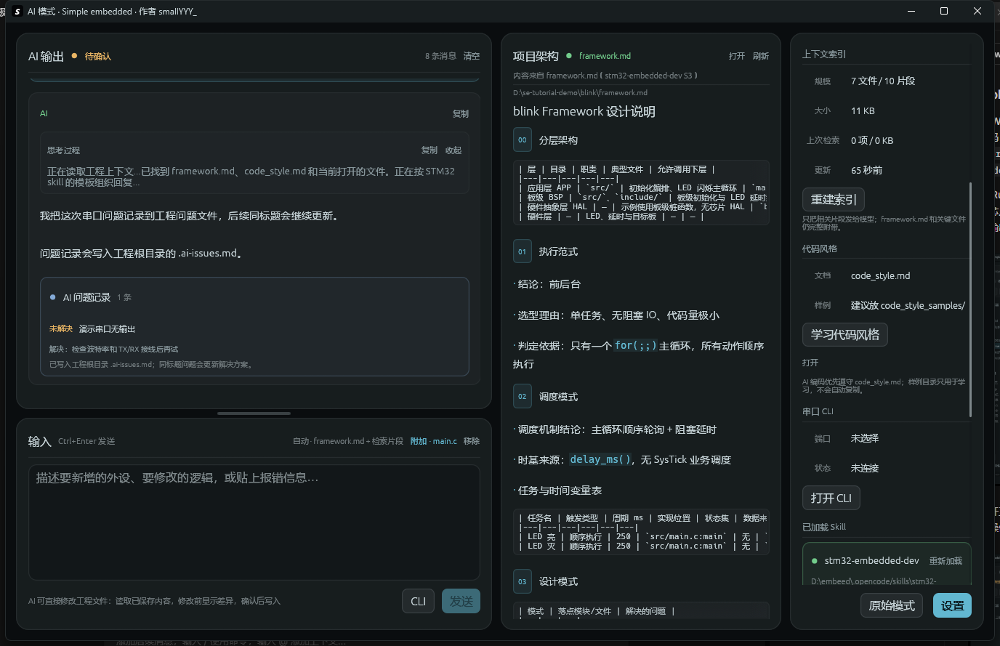

- 显示当前端口和连接状态。
- **打开 CLI** 打开完整串口窗口。
- 配置保存在工程 `.simple-embedded/settings.json` 的 `cli` 节点。

#### Skill 已加载

- 显示当前 Skill 名称、路径和文件数。
- **重新加载** 重新读取 Skill 目录，修改 Skill 后不用重启。
- Skill 目录不存在时使用编译进 exe 的内置副本。

#### 底部

- **原始模式**：退出 AI 模式。
- **设置**：打开 AI 设置弹窗；AI 模式下 `Ctrl+,` 也可以打开。

### 3.7 AI 设置

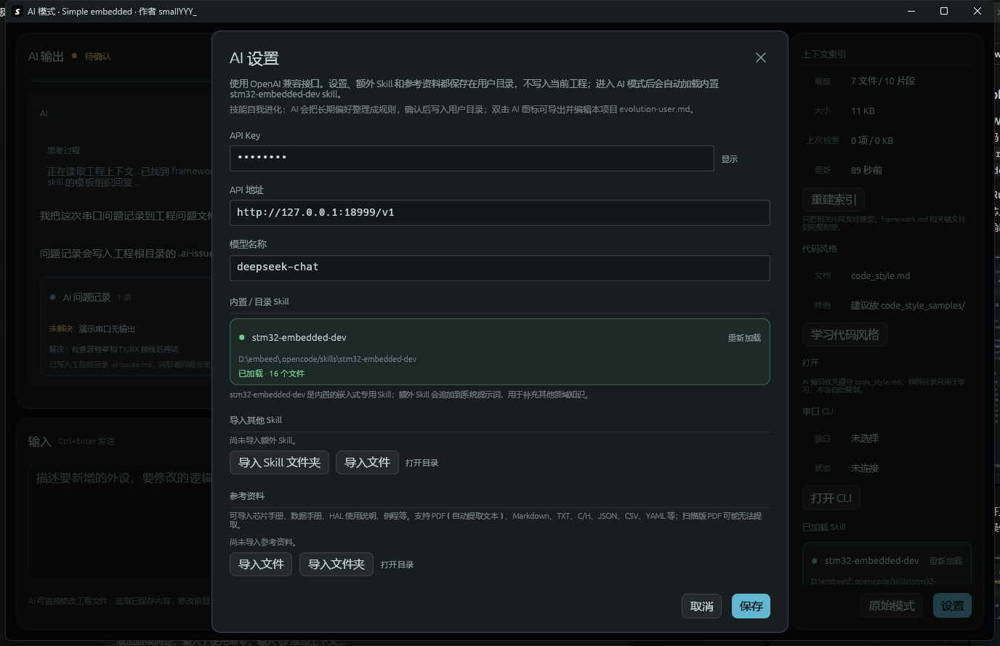

- **API Key**：明文保存在用户目录，不写入工程。
- **API 地址**：OpenAI 兼容接口，默认 `https://api.deepseek.com/v1`。
- **模型名称**：默认 `deepseek-chat`。
- **内置 / 目录 Skill**：显示当前加载的 `stm32-embedded-dev` 路径和文件数，可 **重新加载**。
- **导入其他 Skill**：导入包含 `SKILL.md` / Markdown 的文件夹或单个文件，保存到 `%APPDATA%\SimpleEmbedded\ai\skills\`。
- **参考资料**：导入 PDF、Markdown、TXT、C/H、JSON、CSV、YAML 等，保存到 `%APPDATA%\SimpleEmbedded\ai\references\`。
- PDF 会自动提取文本并写 `<原名>.pdf.txt` 旁车文件；扫描版 PDF 可能无文本。
- **保存 / 取消**：保存后下一条请求生效。

> API Key 是明文保存；请不要把全局设置文件提交到公开仓库。

### 3.8 串口 CLI 窗口

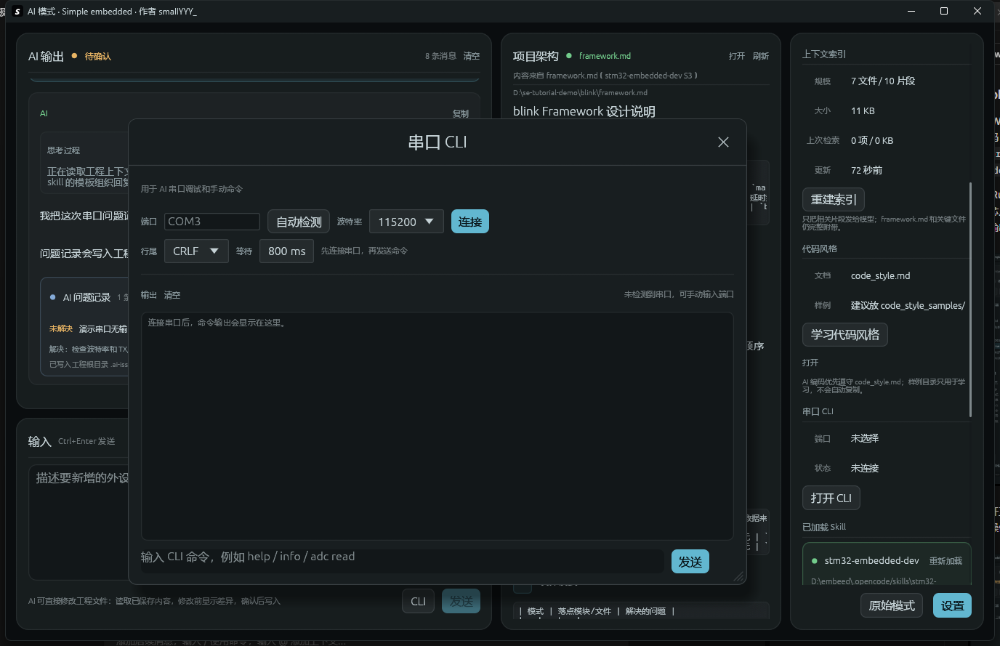

- **端口**：下拉选择；未检测到时可手动输入 `COM3` 或 `/dev/ttyUSB0`。
- **自动检测**：按 USB VID / 产品名优先选择 ESP32、CP210x、CH340、FTDI、PL2303 等。
- **波特率**：默认 115200。
- **行尾**：CRLF / LF / CR。
- **等待**：每条命令等待时间，默认 800ms。
- **连接 / 断开**：连接后命令输出显示在下方。
- **输出**：显示接收内容，可 **清空**。
- **命令输入**：输入 `help`、`info`、`adc read` 等，点 **发送** 或回车。
- 同一时间只保留一个 CLI 会话；关闭窗口、切换工程、退出 AI 模式或退出应用会断开。

固件侧需要实现 CLI：在 UART 初始化后调用 `cli_init()`，主循环调用 `cli_poll()`。Skill 的 `references/serial-cli.md` 提供了骨架和 `help` / `info` / `OK` / `ERR` 响应约定。

### 3.9 典型 AI 工作流

#### 理解别人的工程

1. 打开工程后说“先阅读并理解这个工程，判断它是不是默认架构，再决定 framework.md 怎么处理”。
2. AI 按 T8 盘点构建、目录、入口、启动/链接脚本、RTOS/厂商代码和现有文档。
3. 它给出“默认 / 兼容 / 外来 / 混合”结论和证据，不会直接套默认结构。
4. 需要时用 `se-ask` 选择保留现状、增量补全、替换 framework.md 或迁移目录。
5. 确认后才写 `framework.md`；重构方案另走 T1/T2/T3/T6，不直接改代码。

#### 修改代码

1. 在输入框描述需求，例如“给 main.c 加一个 1 秒心跳，并更新 framework.md”。
2. AI 先读取 `framework.md`、`code_style.md`、`hardware.dts` 和检索到的源文件。
3. 回复中出现 **AI 文件修改** 卡片。
4. 展开差异检查，点 **应用此文件** 或 **应用全部**。
5. 应用后文件树、符号、调用关系和架构面板自动刷新。

#### 处理匹配失败

1. 卡片中某个文件显示 `SEARCH 片段 1 匹配到 0 处`。
2. 如果 SEARCH 是行内片段却被围栏换行带出了末尾换行，IDE 会自动去掉末尾换行再匹配一次；仍失败时点 **分析原因**，IDE 发送原 SEARCH / REPLACE、当前文件和哈希。
3. AI 重新生成这一处；其他文件仍可单独应用。
4. 如果还失败，先保存文件或重新发送请求，不要强行应用。

#### 构建验证

1. AI 用 `se-build` 请求构建。
2. IDE 执行真实 Build，把压缩后的日志发回。
3. 有 error 时 AI 修复并再次构建，最多 5 轮。
4. 0 error 后 AI 给出最终总结。

#### 串口验证

1. 先烧录新固件，并确认 CLI 已实现。
2. AI 用 `se-cli` 发送 `help` / `info` / 业务命令。
3. IDE 回传真实输出；无响应时给出排查步骤，不会写“测试通过”。
4. 需要手动调试时点 **CLI** 打开串口窗口。

#### 记录问题

1. 现象、原因、解决方案明确后，AI 用 `se-issue` 写入 `.ai-issues.md`。
2. 同标题问题再次出现时会更新，而不是重复追加。
3. `status=resolved` 表示已解决。

#### 代码风格

1. 把参考代码放到 `code_style_samples/`，或直接放在工程根目录。
2. 点 **代码风格 → 学习代码风格**。
3. AI 生成 `code_style.md`，包含规则、正例、反例和自查清单。
4. 之后编码优先遵守；需要审计时说“按 code_style.md 审计风格并列出偏差”。
5. 需要优化时说“按 code_style.md 做极致优化”，AI 必须先写目标、约束、测量方法和回退。

### 3.10 Skill 的任务类型

AI 按 skill 的四层执行器工作：L0 硬规则 O1–O14 → L1 任务编排与模板匹配 → L2 任务注册表（guard / accept / on_error）→ L3 模板输出。AI 会先判定任务类型，再套用固定模板：

| 类型 | 适用场景 | 典型产物 |
|---|---|---|
| T1 整机 / 新功能 | 新板级设计、≥2 类外设、从需求到完整程序 | hardware.dts、分层代码、framework.md |
| T2 单外设增补 | 加一路串口、ADC、PWM、传感器驱动 | 增量台账、单模块代码、构建验证 |
| T3 现有逻辑修改 | 硬件不变，改参数、状态机、协议、已定位 bug | 最小改动表、修复代码、验证 |
| T4 故障排查 | 编译 / 链接 / HardFault / 运行现象 | 可能故障位置、诊断代码、串口或 LED/GPIO 验证 |
| T5 台账维护 | 只增删改 hardware.dts | 台账片段 |
| T6 其他操作 | 删除、重命名、移动、配置、文档、咨询 / 方案设计 | 操作清单、影响分析、方案对比 |
| T7 代码风格 | 学习 / 更新 code_style.md、风格审计、极致优化 | code_style.md、偏差表、优化方案 |
| T8 系统整体感知 | 新导入 / 别人的工程、架构归属判断、生成或替换 framework.md、决定是否重构 | 工程盘点表、归属结论、framework.md 方案、迁移计划 |

T4 没有串口时，AI 会要求用 LED 闪烁码、GPIO 电平 / 脉冲、蜂鸣器、调试器 watch / 寄存器 / 断点等可观测方式验证，不会跳过验证。

T8 默认只做感知和文档方案：不会直接按默认 `APP/MID/BSP` 生成架构，也不会改业务代码或移动目录；替换 `framework.md` 或重构前会用 **AI 需要确认** 卡片询问。外来工程可以保留原目录，`framework.md` 记录真实层级和默认层映射；迁移方案会给出影响、验证和回退。

### 3.11 对话记录与问题记录

- 进入 AI 模式时自动读取工程根目录 `<工程名>.ai-chat.md`，不存在时创建。
- 发送消息、AI 回复完成、清空聊天、退出 AI 模式和切换工程时写回。
- 文件是普通 Markdown：每条消息用隐藏 HTML 标记分隔，正文和可折叠的思考过程都能直接阅读。
- 待应用的修改 / 删除 / 确认卡片以“历史记录”小节写入；重新加载后只显示文本，不会恢复成可执行按钮。
- 文件超过约 2MB 时只保留最近消息并标注截断。
- **清空** 会同时清空该工程的对话历史。
- `<工程名>.ai-issues.md` 保存问题记录，按标题合并。
- AI 不能通过 `se-file` / `se-delete` 修改或删除这两个文件。

### 3.12 AI 模式注意事项

- 没有 function calling、自动应用、一键撤销；所有文件修改和删除都要你确认。
- API Key 明文保存在 `%APPDATA%\SimpleEmbedded\settings.json`。
- 没有请求取消；停止 / 清空 / 切换工程只丢弃接收端，后台线程可能持续到读超时。
- 上下文可能超过小模型窗口，错误会显示在聊天里。
- `framework.md` 是架构面板的唯一数据源；没有文档时不会用启发式结果替代。
- 上下文索引是词法检索，不理解同义词、类型关系或宏展开；大工程只覆盖前一部分。
- AI 可以用 `se-list` / `se-read` 自主检索工程目录和文件；单文件 24KB、单轮 48KB、最多 12 个请求、自动继续 6 轮。模型仍可能不主动使用，可以直接要求“先 se-read 读取 xxx 再改”。
- 用户确认执行后，AI 不应只写“我将落盘/接下来修改”或重复读取同一文件；O14 要求已有正文直接输出 `se-replace` / `se-file`，同一文件不得连续 `se-read` 两次，读完后的下一轮必须落盘。
- 聊天历史最多 20 条：普通消息每条 32k 字符、检索消息 48k 字符、总计 128k 字符，模型在后续轮次能记住更长的文件和结论；生成中正文预览最近 48KB，完成后显示全文。
- T8 默认只做感知和文档方案，不会自动重构目录或改业务代码；替换 `framework.md` 和迁移目录都要你先确认，实际重构按 T1/T2/T3/T6 执行。
- 构建验证和串口验证最多自动回传 5 轮；达到上限后需要手动继续。
- 串口 CLI 需要固件已实现 CLI 并烧录；端口错误、被占用或未运行 `cli_poll()` 只会回传真实失败原因。
- 删除只支持工程内普通文件，不支持目录、重命名或移动。
- 应用修改前会备份到用户目录；需要回退时从备份目录复制回原相对路径。

---

## 4. 截图索引

| 图 | 文件 | 内容 |
|---|---|---|
| 01 | [01-main.png](screens/01-main.png) | 原始模式主界面 |
| 02 | [02-build.png](screens/02-build.png) | 构建输出 |
| 03 | [03-find.png](screens/03-find.png) | 当前文件查找 |
| 04 | [04-config-build.png](screens/04-config-build.png) | 配置：构建 |
| 05 | [05-config-editor.png](screens/05-config-editor.png) | 配置：编辑器 |
| 06 | [06-config-debug.png](screens/06-config-debug.png) | 配置：调试 |
| 07 | [07-config-other.png](screens/07-config-other.png) | 配置：其他 |
| 08 | [08-settings-theme.png](screens/08-settings-theme.png) | 应用设置：主题 |
| 09 | [09-project-info.png](screens/09-project-info.png) | 工程信息：烧录配置 |
| 10 | [10-c-props.png](screens/10-c-props.png) | 工程信息：C/C++ 属性 |
| 11 | [11-ai-overview.png](screens/11-ai-overview.png) | AI 模式总览 |
| 12 | [12-ai-edit.png](screens/12-ai-edit.png) | AI 文件修改卡片 |
| 13 | [13-ai-ask.png](screens/13-ai-ask.png) | AI 需要确认卡片 |
| 14 | [14-ai-delete.png](screens/14-ai-delete.png) | AI 文件删除卡片 |
| 15 | [15-ai-issue.png](screens/15-ai-issue.png) | AI 问题记录卡片 |
| 16 | [16-ai-workbench.png](screens/16-ai-workbench.png) | AI 工作台：索引与代码风格 |
| 17 | [17-ai-workbench-cli.png](screens/17-ai-workbench-cli.png) | AI 工作台：串口 CLI 与 Skill |
| 18 | [18-ai-cli-window.png](screens/18-ai-cli-window.png) | 串口 CLI 窗口 |
| 19 | [19-ai-settings.png](screens/19-ai-settings.png) | AI 设置 |
| 20 | [20-ai-architecture.png](screens/20-ai-architecture.png) | 项目架构面板 |
| 21 | [21-ai-build.png](screens/21-ai-build.png) | AI 构建验证卡片 |
| 22 | [22-ai-cli-card.png](screens/22-ai-cli-card.png) | AI 串口 Debug 卡片 |

---

## 5. 常见问题

**构建命令和工具链不一致怎么办？**
在 **配置 → 构建 → 工具链** 选择正确工具链，并把 Build 命令改成对应命令。工具链下拉只影响元数据和构建选项展示，不会自动改写 Build 命令。

**烧录找不到程序文件？**
先构建，然后在 **工程信息 → 烧录配置** 里检查程序文件路径。OpenOCD / pyOCD 不会自动构建。

**Keil 工程会被修改吗？**
不会。软件不修改 `.uvprojx`；Keil 构建选项只写入工程配置。

**AI 没有生成 `framework.md` 怎么办？**
进入 AI 模式，中间面板点 **让 AI 生成**，或直接说“生成 framework.md”。没有文档时面板不会用启发式结果替代。

**AI 修改应用失败？**
先保存打开的文件，再点 **分析原因**。`SEARCH` 必须唯一匹配；文件在 AI 生成后发生变化也会拒绝。

**AI 串口测试没有输出？**
检查端口、波特率、TX/RX 接线、固件是否运行 `cli_poll()`，以及串口是否被其他程序占用。没有串口时用 LED 闪烁码、GPIO 或调试器 watch 验证。

**主题想恢复默认？**
**设置 → 编辑器主题 → 恢复默认 → 保存**。

**想删除工程内的旧文件？**
让 AI 用 `se-delete` 提出删除，确认卡片后再执行；删除前会备份，一次最多 10 个普通文件。

---

更多细节可以继续查阅：

- [TUTORIAL.md](TUTORIAL.md)：完整操作教程
- [FLASH.md](FLASH.md)：烧录配置
- [DYNAMIC.md](DYNAMIC.md)：动态监测
- [README.md](../README.md)：功能列表和项目定位
