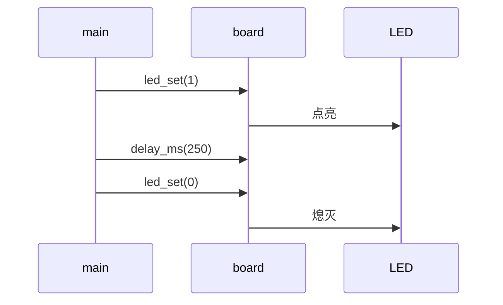

# blink Framework 设计说明

> 示例工程的架构说明，用于演示 `framework.md` 如何驱动 Simple embedded 的项目架构面板。

## 1. 分层架构

### 1.1 层级表

| 层 | 目录 | 职责 | 典型文件 | 允许调用下层 |
|---|---|---|---|---|
| 应用层 APP | `src/` | 初始化编排、LED 闪烁主循环 | `main.c` | 板级 |
| 板级 BSP | `src/`、`include/` | 板级初始化与 LED 延时封装 | `board.c`、`board.h` | HAL / 硬件 |
| 硬件抽象层 HAL | — | 示例使用板级桩函数，无芯片 HAL | `board.h` | 硬件层 |
| 硬件层 | — | LED、延时与目标板 | — | — |

### 1.2 目录树

```text
blink/
├── src/
│   ├── main.c
│   └── board.c
├── include/
│   └── board.h
└── Makefile
```

## 2. 软件架构

### 2.1 执行范式

- 结论：前后台
- 选型理由：单任务、无阻塞 IO、代码量极小
- 判定依据：只有一个 `for(;;)` 主循环，所有动作顺序执行

### 2.2 调度模式

- 调度机制结论：主循环顺序轮询 + 阻塞延时
- 时基来源：`delay_ms()`，无 SysTick 业务调度
- 任务与时间变量表

| 任务名 | 触发类型 | 周期 ms | 实现位置 | 状态集 | 数据来源/去向 |
|---|---|---|---|---|---|
| LED 亮 | 顺序执行 | 250 | `src/main.c:main` | 无 | `board.c:led_set(1)` |
| LED 灭 | 顺序执行 | 250 | `src/main.c:main` | 无 | `board.c:led_set(0)` |

### 2.3 设计模式清单

| 模式 | 落点模块/文件 | 解决的问题 |
|---|---|---|
| 板级封装 | `board.c` / `board.h` | 隔离 LED 与延时的具体实现 |
| 顺序状态循环 | `src/main.c:main` | 用最简单的前后台循环实现闪烁 |

## 3. 运行视图

### 3.1 启动调用链

```mermaid
sequenceDiagram
    participant R as Reset
    participant M as main
    participant B as board_init
    participant L as LED loop
    R->>M: 复位入口
    M->>B: board_init()
    B-->>M: 板级就绪
    M->>L: for(;;) LED 闪烁
```

### 3.2 主循环调度时间线

```mermaid
gantt
    title blink 主循环时间线（示意）
    dateFormat X
    axisFormat %s ms
    section 主循环
    LED 亮(250ms) :active, a1, 0, 250
    LED 灭(250ms) :a2, after a1, 250
    section 系统
    delay_ms 阻塞 :crit, d1, 0, 500
```



### 3.3 中断来源与抢占关系表

| 中断源 | 优先级 | 被抢占任务 |
|---|---|---|
| N/A | N/A | 本示例未使用中断 |

### 3.4 关键事件上下文链


