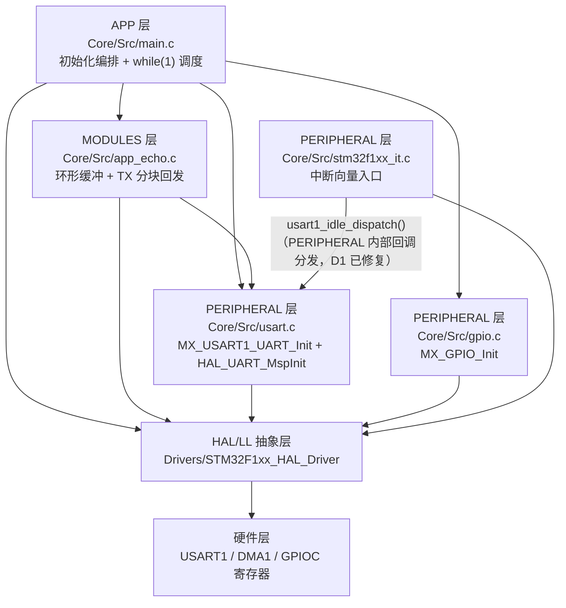
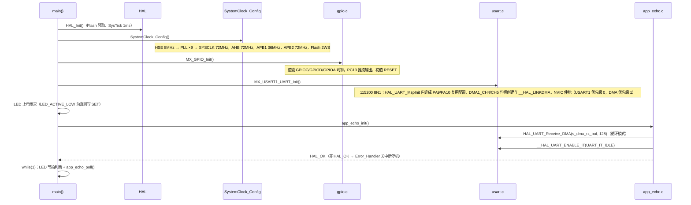
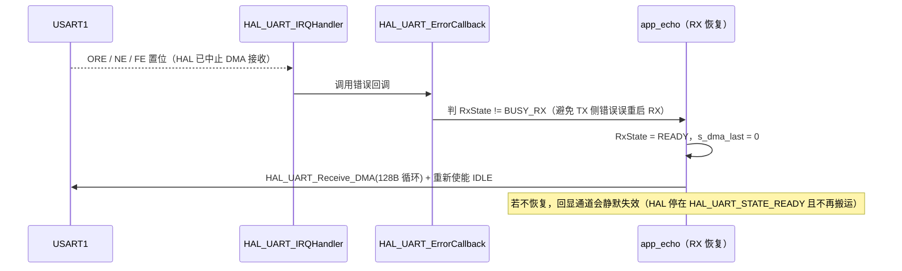

# test32 Framework 设计说明

> 硬件参数来源：`hardware.dts`（同目录，本次无变更）。
> 本文档描述当前已实现代码：CubeMX 生成工程骨架 + USART1 DMA 回显（`Core/Src/app_echo.c`）+ PC13 LED 非阻塞闪烁（`Core/Src/main.c` USER CODE 3）。
> 标注约定：`[预估]` = 按 72MHz / Cortex-M3 / Flash 2WS 估算的量级值；`[待回填]` = 需实测填入，禁止编造；`TODO` = 手册事实待核对，见 `hardware.dts` 待核对汇总块。

## 1. 分层架构

### 1.1 层级表

| 层 | 目录 | 职责 | 典型文件 | 允许调用下层 |
|---|---|---|---|---|
| 应用层 APP | `Core/Src`（USER CODE 2/3 区） | 初始化编排、主循环调度、LED 节拍、回显轮询 | `main.c` | BSP/MODULES、PERIPHERAL、HAL |
| 中间件层 MID（调度/日志/错误码） | 未建立 | N/A（任务仅 2 个，用主循环时间戳比较替代调度器；无日志与统一错误码） | — | — |
| 驱动层 BSP-MODULES（业务搬运模块） | `Core/Src`、`Core/Inc` | 回显通道：DMA/IDLE 分段搬运、环形缓冲、TX 分块串行化、错误恢复 | `app_echo.c`、`app_echo.h` | PERIPHERAL 实例、HAL |
| 驱动层 BSP-PERIPHERAL（外设驱动） | `Core/Src`、`Core/Inc` | USART1 初始化与 DMA 句柄链接、PC13 GPIO、中断向量入口 | `usart.c`、`gpio.c`、`stm32f1xx_it.c`、`stm32f1xx_hal_msp.c` | HAL |
| 硬件抽象层 HAL/LL | `Drivers/STM32F1xx_HAL_Driver`、`Drivers/CMSIS` | 寄存器封装、句柄管理 | `stm32f1xx_hal_*.c` | 硬件层 |
| 硬件层 | — | 寄存器、8MHz 晶振、USB-TTL 接线、PC13 LED | — | — |

### 1.2 目录树

```text
test32/
├── Core/
│   ├── Inc/
│   │   ├── main.h                  # APP/PERIPHERAL 公共宏（LED_* 参数宏，与台账 led_status 同源）
│   │   ├── app_echo.h              # MODULES：回显接口 + 参数宏（128 / 256 / 64，与台账 &uart1 同源）
│   │   ├── usart.h                 # PERIPHERAL：huart1 句柄 extern + MX_USART1_UART_Init 声明
│   │   ├── gpio.h                  # PERIPHERAL：MX_GPIO_Init 声明
│   │   ├── stm32f1xx_it.h          # PERIPHERAL：中断入口声明（含 DMA1_CH4/CH5）
│   │   └── stm32f1xx_hal_conf.h    # HAL 模块裁剪（已启用 UART/DMA/GPIO/RCC/FLASH/CORTEX）
│   └── Src/
│       ├── main.c                  # APP：初始化编排 + while(1) 调度（LED 节拍、app_echo_poll）
│       ├── app_echo.c              # MODULES：IDLE 分段搬运 / 环形缓冲 / TX 分块 / 错误恢复
│       ├── usart.c                 # PERIPHERAL：MX_USART1_UART_Init + HAL_UART_MspInit（引脚/DMA/NVIC）
│       ├── gpio.c                  # PERIPHERAL：MX_GPIO_Init（PC13 推挽输出）
│       ├── stm32f1xx_it.c          # PERIPHERAL：向量入口（SysTick / USART1 / DMA1_CH4 / DMA1_CH5）
│       ├── stm32f1xx_hal_msp.c     # PERIPHERAL：全局 MSP（AFIO/PWR/SWJ_NOJTAG）
│       ├── system_stm32f1xx.c      # CMSIS：SystemInit / SystemCoreClockUpdate
│       └── syscalls.c / sysmem.c   # C 库桩（__io_putchar 重定向、_sbrk 堆尾保护）
├── Drivers/                        # HAL / CMSIS 库源码（只读，禁止改动）
├── MID/                            # 未建立：无调度器 / 设备管理器 / 日志 / 统一错误码
├── BSP/                            # 未建立：现有驱动按 CubeMX 惯例落在 Core/Src、Core/Inc
├── build/                          # 构建产物（不入库）
├── hardware.dts                    # 硬件资源台账（参数唯一来源）
├── framework.md                    # 本文档
├── test32.ioc                      # CubeMX 配置（USART1 / PC13 / SWD / HSE / SysTick）
├── Makefile                        # mingw32-make 构建脚本
├── STM32F103XX_FLASH.ld            # 链接脚本（64KB Flash / 20KB RAM）
└── startup_stm32f103xb.s           # 向量表与复位入口
```

### 1.3 调用方向图



### 1.4 模块依赖矩阵

| 模块(行) \ 依赖(列) | MODULES-echo (`app_echo.c`) | PERIPH-usart1 (`usart.c`) | PERIPH-gpio (`gpio.c`) | PERIPH-it (`stm32f1xx_it.c`) | HAL-UART | HAL-DMA / NVIC | HAL-GPIO |
|---|---|---|---|---|---|---|---|
| APP `main.c` | `app_echo_init()` / `app_echo_poll()` | `MX_USART1_UART_Init()` | `MX_GPIO_Init()` | — | `HAL_GetTick()`（间接） | — | `HAL_GPIO_WritePin` / `HAL_GPIO_TogglePin` |
| MODULES `app_echo.c` | — | `huart1`（extern 句柄） | — | — | `HAL_UART_Receive_DMA` / `HAL_UART_Transmit_DMA` / `__HAL_UART_ENABLE_IT` | `__HAL_DMA_GET_COUNTER` | — |
| PERIPH `usart.c` | — | — | — | — | `HAL_UART_Init` | `HAL_DMA_Init` / `__HAL_LINKDMA` / `HAL_NVIC_SetPriority` / `HAL_NVIC_EnableIRQ` | — |
| PERIPH `gpio.c` | — | — | — | — | — | — | `HAL_GPIO_Init` |
| PERIPH `stm32f1xx_it.c` | —（经 `usart1_idle_dispatch()` 回调到 `app_echo_idle_isr`，无编译期依赖） | `usart1_idle_dispatch()` / `huart1` | — | — | `HAL_UART_IRQHandler` | `HAL_DMA_IRQHandler` | — |
| HAL 库 | — | — | — | — | 寄存器访问 | 寄存器访问 | 寄存器访问 |

## 2. 软件架构

### 2.1 执行范式

- 结论：**前后台范式（foreground/background）**——主循环顺序调度（后台批量处理）+ 硬件中断响应即时事件（前台），不使用 RTOS，不使用事件队列内核。
- 选型理由：
  1. 资源约束：RAM 仅 20KB（`hardware.dts` `memory-map`），任务仅 2 个（LED 节拍、回显发送调度），收发全由 DMA 异步承担，无阻塞等待场景；引入 RTOS 的栈开销与调试成本不划算。
  2. 抢占需求：必须即时响应的事件只有「帧结束（IDLE）」与「TX 完成（DMA TC）」，由硬件中断直接承担，中断内只搬运/释放发送权，无需任务级抢占。
  3. 时延可接受：单次任务动作量级 < 50us[预估]，远小于 1ms 时基与 115200bps 单字符时间（约 87us），主循环轮询不会造成丢字节（DMA + 环形缓冲吸收抖动）。
- 判定依据：内存约束 = 紧张（可用 RAM 约 20KB，已用缓冲 128+256+64 B）；抢占需求 = 无（回显为尽力而为，允许毫秒级延迟）；阻塞等待占比 ≈ 0（无 `HAL_Delay` 等裸阻塞，`app_echo_poll` 无数据立即返回）。

### 2.2 调度模式

- 调度机制结论：**非抢占时间片轮询（时间戳比较式）+ 中断侧事件驱动**。未使用注册表调度器（任务数 < 5，`software-arch.md` 3.2.3 适用），范式与调度相互匹配（前后台不引入 RTOS 阻塞语义与优先级抢占）。
- 时基来源：SysTick 1ms 中断（`TICK_INT_PRIORITY = 15`，最低优先级）→ `HAL_IncTick()` 递增 HAL 内部 `uwTick`（`volatile`）→ 主循环通过 `HAL_GetTick()` 读取；未另建软件定时器变量。
- 双线程结构：循环线程 = `while(1)` 内「LED 节拍判断 + `app_echo_poll()`」两段，顺序即等效静态优先级（LED 判断在前、回显调度在后，两者均微秒级）。

| 任务名 | 触发类型(周期/一次性/条件) | 周期 ms | 实现位置(文件:函数) | 状态集 | 数据来源/去向 |
|---|---|---|---|---|---|
| LED 翻转节拍 | 周期性（时间戳差 ≥ `LED_BLINK_INTERVAL_MS`） | 1000（半周期；完整翻转周期 2000） | `Core/Src/main.c` : `while(1)` USER CODE 3 | 无状态机，`s_led_last_tick` 仅记录上次命中时刻 | `HAL_GetTick()` → `HAL_GPIO_TogglePin(GPIOC, PIN_13)` |
| 回显发送调度 | 条件性（环形缓冲非空 且 `s_tx_busy == 0`） | —（每轮循环检查，无固定间隔） | `Core/Src/app_echo.c` : `app_echo_poll()` | `s_tx_busy ∈ {0 空闲, 1 在途}` | `s_rx_ring` → `s_tx_chunk`（≤64 B）→ `HAL_UART_Transmit_DMA` |
| 接收分段搬运 | 一次性（事件触发：每帧 IDLE 中断一次） | —（由帧间隔决定） | `Core/Src/app_echo.c` : `app_echo_idle_isr()` | `s_dma_last`（DMA 已写入位置） | `s_dma_rx_buf` + `CNDTR` → `s_rx_ring`（含回绕处理） |
| TX 完成释放 | 一次性（DMA1_CH4 传输完成中断） | — | `Core/Src/app_echo.c` : `HAL_UART_TxCpltCallback()` | `s_tx_busy = 0` | DMA1_CH4 TC → 释放发送权，允许下一块 |

### 2.3 设计模式清单

| 模式 | 落点模块/文件 | 解决的问题 |
|---|---|---|
| 生产者-消费者环形缓冲 | `Core/Src/app_echo.c` : `s_rx_ring` / `s_rx_head` / `s_rx_tail` | ISR 生产、主循环消费，单生产者单消费者无锁协作，隔离 DMA 速度与回发速度 |
| 单例句柄（static 私有实例 + 接口暴露） | `Core/Src/app_echo.c` 全部模块变量 `static`，对外仅 `app_echo_init/poll/idle_isr/overflow_count`；`Core/Src/usart.c` 的 `huart1` | 替代 `extern` 全局变量，防止跨模块直接改内部状态（`module-convention.md` 方式 B） |
| 回调注册（HAL 弱回调覆盖） | `Core/Src/app_echo.c` : `HAL_UART_TxCpltCallback` / `HAL_UART_ErrorCallback` | 解耦「DMA 传输完成 / 总线错误」事件与业务处理，回调内只做状态释放与接收恢复 |
| 轻量状态标志串行化（单块在途） | `Core/Src/app_echo.c` : `s_tx_busy` + `s_tx_chunk` | 避免重叠启动 TX DMA 导致数据错乱；单帧超过 64 B 时由下一轮 poll 自动续发 |

未使用（当前无对应需求，后续扩展时再登记）：显式 `switch-case` 协议状态机、MID 设备管理器注册表、门面/解释层高级 API。

### 2.4 模块化要点

- 私有变量与 get/set 接口清单：`app_echo.c` 内 `s_dma_rx_buf`、`s_dma_last`、`s_rx_ring`、`s_rx_head`、`s_rx_tail`、`s_rx_overflow`、`s_tx_chunk`、`s_tx_busy` 全部 `static`；对外只暴露 `app_echo_overflow_count()` 作为只读观测接口（其余为动作接口，无写接口）。
- 句柄实例清单：

| 模块 | 获取函数 | 绑定的外设句柄 |
|---|---|---|
| USART1 外设驱动 | 直接引用 `extern huart1`（`Core/Inc/usart.h`） | `USART1`（CubeMX 生成的全局句柄） |
| 回显模块（MODULES） | 无句柄，全 `static` 单例，经 `app_echo_*` 接口访问 | 使用 `huart1.hdmarx` / `huart1.hdmatx`（由 `HAL_UART_MspInit` 创建并 `__HAL_LINKDMA` 关联，须早于 `HAL_UART_Init` 内部配置；TODO：核对 `Core/Src/usart.c` 实际实现位置） |
| LED GPIO | 无模块句柄，使用 `main.h` 宏 `LED_GPIO_PORT` / `LED_GPIO_PIN` | `GPIOC` / `GPIO_PIN_13` |

- 单向依赖约束执行情况（对照 `architecture.md` D1–D6）：
  - D1：已修复——`Core/Src/stm32f1xx_it.c`（PERIPHERAL）不再直接调用 MODULES；改由 `Core/Src/usart.c` 提供 `usart1_set_idle_callback()` / `usart1_idle_dispatch()` 分发，`app_echo.c`(MODULES) 在 `app_echo_init()` 中注册 `app_echo_idle_isr`，编译期无反向依赖。
  - D2：无（`app_echo.c` 只访问 `huart1` 公开句柄，不触碰他模块私有变量）。
  - D3：无循环 include（`app_echo.h` 只包含 `main.h`）。
  - D4：`main.c` 未直接操作寄存器或外设位；`HAL_GPIO_TogglePin` 属 APP 层使用 GPIO 接口的既有写法，登记为现状。
  - D5：无第三方库。

### 2.5 共享数据与临界区

| 共享数据 | 生产者(ISR/任务) | 消费者 | 保护方式(volatile/环形缓冲/临界区/互斥量) |
|---|---|---|---|
| `s_dma_rx_buf[128]` | DMA1_CH5（硬件写） | `app_echo_idle_isr()` | 硬件循环指针 + `__HAL_DMA_GET_COUNTER` 计算写入位置；CPU 只读不写，按半开区间 `[from, to)` 搬运 |
| `s_dma_last` | `app_echo_idle_isr()` | `app_echo_idle_isr()`（下次进入） | `volatile uint16_t`，仅 ISR 上下文读写，无并发 |
| `s_rx_ring[256]` / `s_rx_head` / `s_rx_tail` | head：ISR；tail：主循环 | 主循环 / ISR | `volatile` + 单生产者单消费者索引 + 取模 `APP_ECHO_RX_RING_SIZE`；16 位对齐读写原子（Cortex-M3），不需关中断 |
| `s_rx_overflow` | `app_echo_idle_isr()`（缓冲满时递增） | `app_echo_overflow_count()`（主循环） | `volatile uint32_t`，只做计数上报，不参与控制流 |
| `s_tx_chunk[64]` / `s_tx_busy` | 主循环填块并置位；`HAL_UART_TxCpltCallback` 清零 | DMA1_CH4 / 主循环 | `s_tx_busy` 为 `volatile uint8_t`；同一时刻只有一块在途，天然串行化 |
| `uwTick`（HAL 内部） | `SysTick_Handler` → `HAL_IncTick()` | `HAL_GetTick()` 调用方 | HAL 内部 `volatile` 计数；主循环只读比较，差值运算无溢出风险（无符号） |
| `huart1.RxState` | `HAL_UART_ErrorCallback`（恢复时改写） | HAL 状态机 | 仅在 RX 不处于 `BUSY_RX` 时改写并重启接收，避免与进行中的 DMA 状态冲突 |

## 3. 运行视图

### 3.1 启动调用链（初始化顺序）



### 3.2 主循环调度时间线

```mermaid
gantt
    title 主循环调度时间线（规划视图，耗时均为 [预估]，实测待回填）
    dateFormat X
    axisFormat %s ms
    section 主循环 1ms 内一轮（非抢占）
    LED 节拍判断（HAL_GetTick 差值）      :active, a1, 0, 1
    app_echo_poll（无数据立即返回）       :a2, after a1, 1
    下一轮循环                            :a3, after a2, 1
    section 命中事件（示意时刻）
    LED 翻转命中（1000ms 一次）           :milestone, m1, 1000, 0
    环形缓冲非空续发（随时）              :milestone, m2, 3, 0
    section 异步中断（打断主循环）
    SysTick 1ms 时基                      :milestone, i1, 1, 0
    USART1 IDLE 帧结束                    :milestone, i2, 30, 0
    DMA1_CH4 TX 完成                      :milestone, i3, 45, 0
```



说明：主循环无固定节拍，一轮耗时 < 10us[预估]，因此实际以「尽可能快地重复轮询」运行；上图按 1ms 时基标注便于与 SysTick 对齐，中断条带时刻仅为示意，不代表真实相位。空闲时（无串口数据）主循环只剩时间戳比较，属忙等空转，未启用低功耗睡眠（如需降功耗，可在 `app_echo_poll()` 返回无数据后进入 `__WFI()`，需另评估唤醒源）。

### 3.3 中断来源与抢占关系表

| 中断源 | 向量/IRQn | 优先级 | 触发条件 | ISR 主要动作 | 抢占对象 | 备注 |
|---|---|---|---|---|---|---|
| SysTick | `SysTick_Handler`（内核异常，编号 -1） | 15（最低） | 每 1ms | `HAL_IncTick()` 递增 `uwTick` | 主循环任意位置 | 时基来源；`.ioc` NVIC.SysTick_IRQn=true:15:0 |
| USART1 | `USART1_IRQn = 37` | 0（最高） | RX 线路空闲 ≥1 字符（IDLE）/ 帧错误 / TC | 先 `usart1_idle_dispatch()` → 已注册回调 `app_echo_idle_isr()`：读 SR→读 DR 清 IDLE、算 `pos`、搬运到环形缓冲；再 `HAL_UART_IRQHandler(&huart1)` 处理错误与 TC | 主循环、DMA 中断、SysTick | IRQn 与优先级已在台账销项；ISR 内不发送、不打印、不阻塞 |
| DMA1_Channel4（USART1_TX） | `DMA1_Channel4_IRQHandler`，IRQn = 14（TODO：按 RM 中断向量表核对） | 1 | TX DMA 传输完成 | `HAL_DMA_IRQHandler(huart1.hdmatx)` → 回调链到 `HAL_UART_TxCpltCallback` → `s_tx_busy = 0` | 主循环、SysTick | 优先级低于 USART1，高于 SysTick；台账 `&dma1` 记录优先级 1 |
| DMA1_Channel5（USART1_RX） | `DMA1_Channel5_IRQHandler`，IRQn = 15（TODO：按 RM 中断向量表核对） | 1 | 循环模式半满/全满 | `HAL_DMA_IRQHandler(huart1.hdmarx)` | 主循环、SysTick | 本工程数据搬运依赖 IDLE 中断，不依赖 HT/TC；该中断主要用于维持 HAL DMA 状态一致 |
| NMI / HardFault / MemManage / BusFault / UsageFault | 内核异常 | 0 | 异常发生 | `while(1)` 死循环（CubeMX 默认） | 全部 | 现场需调试器读 `SCB->CFSR/HFSR` 与栈帧（`debug-playbook.md` H1–H5） |

抢占关系链：`USART1(0)` ⊃ `DMA1_CH4/CH5(1)` ⊃ `SysTick(15)` ⊃ 主循环。所有 ISR 只做搬运/置标志/释放发送权，最长动作 = 搬运一帧 ≤128 B[预估] < 50us，不会挤占 1ms 时基。

### 3.4 关键事件上下文链

事件 A：PC → 单片机 → PC 回显（正常路径）

```mermaid
sequenceDiagram
    participant PC as PC 串口
    participant HW as USART1 + DMA1_CH5
    participant ISR as app_echo_idle_isr（USART1 ISR）
    participant RING as s_rx_ring 环形缓冲
    participant LOOP as app_echo_poll（主循环）
    participant TX as DMA1_CH4 + 完成回调
    PC->>HW: 连续字节流（115200 8N1，无需 CPU 参与）
    HW->>RING: DMA 循环写入 s_dma_rx_buf（硬件指针推进）
    PC-->>ISR: 帧间隔 ≥1 字符时间 → IDLE 置位
    ISR->>ISR: 读 SR → 读 DR 清 IDLE；pos = 128 - CNDTR
    ISR->>RING: echo_ring_push_range 搬 [s_dma_last, pos)，跨尾部时二次搬运
    LOOP->>RING: echo_ring_pop 取 ≤64 B 到 s_tx_chunk
    LOOP->>TX: HAL_UART_Transmit_DMA，置 s_tx_busy = 1
    TX->>PC: PA9 回发该块
    TX-->>LOOP: TX DMA 完成中断 → HAL_UART_TxCpltCallback → s_tx_busy = 0
    Note over LOOP: 剩余数据由下一轮 poll 续发（分块串行化）
```

事件 B：串口错误（ORE/NE/FE）恢复路径



事件 C：环形缓冲溢出（异常观测路径）

`echo_ring_push()` 发现 `(s_rx_head + 1) % 256 == s_rx_tail` 时丢弃该字节并 `s_rx_overflow++`，ISR 不阻塞；主循环侧可用 `app_echo_overflow_count()` 观测，正常运行应恒为 0（非 0 说明主循环被长期阻塞或 PC 发送过快）。

### 3.5 函数耗时预算表

| 函数/任务 | 调用层级 | 是否含阻塞调用 | 预估耗时[预估] | 实测耗时[待回填] | 观测方法 |
|---|---|---|---|---|---|
| `app_echo_idle_isr()` | ISR（USART1，优先级 0） | 否 | 空帧 < 5us；满帧 128 B < 50us | — | 空闲 GPIO 翻转 + 示波器；或 SystemView 中断跨度 |
| `echo_ring_push_range()` / `echo_ring_push()` | ISR 内联调用 | 否 | 每字节 < 0.5us，128 B < 40us | — | 同上（含在 `app_echo_idle_isr` 跨度内） |
| `HAL_UART_IRQHandler()` | ISR（USART1） | 否 | < 10us | — | 同上 |
| `app_echo_poll()` | 主循环 | 否（`HAL_UART_Transmit_DMA` 仅启动配置） | 无数据 < 2us；触发发送 < 20us | — | 空闲 GPIO 翻转 + 逻辑分析仪 |
| `echo_ring_pop()` | 主循环（poll 内） | 否 | ≤64 次循环 < 10us | — | 含在 `app_echo_poll` 跨度内 |
| `HAL_UART_TxCpltCallback()` | ISR（DMA1_CH4，优先级 1） | 否 | < 2us | — | 空闲 GPIO 翻转 |
| LED 节拍判断 | 主循环 | 否 | < 1us | — | Map/反汇编估算 + GPIO 翻转 |

### 3.6 实测采集指引

| 观测目标 | 工具/手段 | 采集点与条件 |
|---|---|---|
| 主循环一轮耗时、`app_echo_poll` 跨度 | 空闲 GPIO（如 PB0/PB1，需先在台账登记后方可使用）翻转 + 示波器 | `while(1)` 首尾各翻转一次；条件是 PC 以 115200 连续发送 |
| IDLE ISR 耗时与帧间隔 | 逻辑分析仪（PA9 回发波形 + 另一路 ISR 翻转脚） | 发送 1 / 64 / 128 B 三组帧长，读中断跨度 |
| 中断最大延迟 | SystemView / SWO（PB3，需确认 JTAG 已禁用后可用；TODO：核对是否与 SWD 引脚共存可用） | 观察 SysTick 与 USART1 中断的实际到达间隔 |
| 丢字节与溢出 | 软件观测 `app_echo_overflow_count()` + 上位机逐字节比对 | 长时间连续发送，计数应为 0 |
| 回显延迟 | PC 侧时间戳（发送时刻 vs 收齐时刻） | 分块 64 B 场景下延迟上限 ≈ 一块发送时间（约 5.6ms @115200） |
